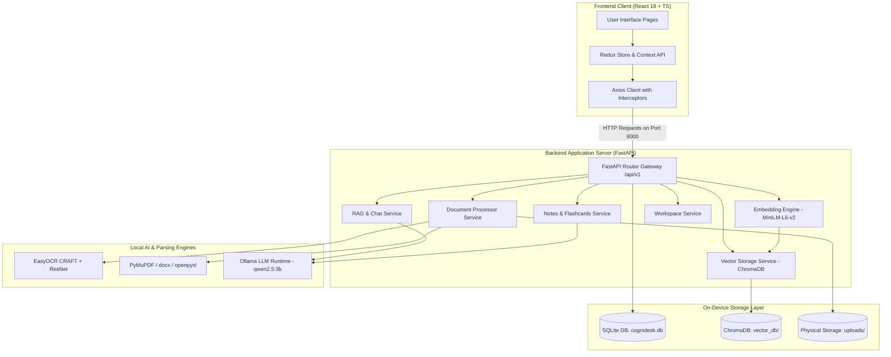

# COGNIDESK: ARCHITECTURE DIAGRAMS & COMPLETE FLOWCHARTS
> **Visual Engineering Blueprint, Data Lifecycles & Pipeline Flowcharts**  
> *Everything documented here represents the actual implemented codebase.*

---

## TABLE OF CONTENTS
1. [High-Level System Architecture Diagram (Text & ASCII)](#1-high-level-system-architecture-diagram)
2. [Mermaid System Architecture Diagram](#2-mermaid-system-architecture-diagram)
3. [Database Entity-Relationship (ER) Diagram](#3-database-entity-relationship-er-diagram)
4. [Flowchart 1: Document Ingestion, Parsing & Chunking Pipeline](#4-flowchart-1-document-ingestion-parsing--chunking-pipeline)
5. [Flowchart 2: Vector Embedding & ChromaDB Indexing Pipeline](#5-flowchart-2-vector-embedding--chromadb-indexing-pipeline)
6. [Flowchart 3: End-to-End RAG Retrieval & Chat Pipeline](#6-flowchart-3-end-to-end-rag-retrieval--chat-pipeline)
7. [Flowchart 4: Offline Image OCR Pipeline (EasyOCR)](#7-flowchart-4-offline-image-ocr-pipeline)
8. [Flowchart 5: AI Notes & Flashcards Generation Pipeline](#8-flowchart-5-ai-notes--flashcards-generation-pipeline)
9. [Flowchart 6: Workspace Switching & Multi-Tenant Data Isolation](#9-flowchart-6-workspace-switching--multi-tenant-data-isolation)
10. [Flowchart 7: Global Error Handling & Axios Interceptors](#10-flowchart-7-global-error-handling--axios-interceptors)

---

## 1. HIGH-LEVEL SYSTEM ARCHITECTURE DIAGRAM

```
====================================================================================================
                                      COGNIDESK CLIENT MACHINE (100% OFFLINE)
====================================================================================================

  +----------------------------------------------------------------------------------------------+
  |                                   FRONTEND: REACT 18 SPA (PORT 5173)                         |
  |                                                                                              |
  |   [ React Router DOM ]                                                                       |
  |     ├── DashboardPage       ├── DocumentsPage     ├── ChatPage        ├── SearchPage         |
  |     ├── NotesPage           ├── FlashcardsPage    ├── KnowledgeBase   ├── SettingsPage       |
  |                                                                                              |
  |   [ State Management Layer ]                                                                 |
  |     ├── WorkspaceContext   --> Tracks active workspace ID & triggers UI auto-refresh          |
  |     ├── ThemeContext       --> Manages Dark / Light mode CSS variables                       |
  |     └── Redux Toolkit      --> Slices: chatSlice, documentsSlice, knowledgeSlice,            |
  |                                toastSlice, uiSlice                                           |
  |                                                                                              |
  |   [ Network Client: Axios apiClient ]                                                        |
  |     ├── Request Interceptor  --> Automatically attaches 'X-Workspace-Id' & Client headers    |
  |     └── Response Interceptor --> Catches errors and dispatches Redux Toast notifications     |
  +-----------------------------------------------+----------------------------------------------+
                                                  |
                                                  | HTTP REST (JSON & Multipart)
                                                  v Port 8000
  +----------------------------------------------------------------------------------------------+
  |                                   BACKEND: FASTAPI SERVER (PORT 8000)                        |
  |                                                                                              |
  |   [ Middleware Layer ]                                                                       |
  |     ├── CORSMiddleware       --> Allows localhost:5173 cross-origin requests                 |
  |     └── Error Handling       --> Global exception handlers converting to JSON details        |
  |                                                                                              |
  |   [ API Routers (/api/v1/) ]                                                                 |
  |     ├── /documents           ├── /rag             ├── /chat           ├── /search            |
  |     ├── /workspaces          ├── /notes           ├── /flashcards     ├── /vector_db         |
  |     └── /health              └── /embeddings                                                 |
  |                                                                                              |
  |   [ Dependency Injection ]                                                                   |
  |     ├── get_db()             --> Provides isolated SQLAlchemy DB session (SessionLocal)      |
  |     └── get_workspace_id()   --> Extracts 'X-Workspace-Id' header or falls back to active   |
  +-------+--------------------+---------------------+--------------------+----------------------+
          |                    |                     |                    |
          v                    v                     v                    v
  +---------------+    +----------------+    +---------------+    +------------------------------+
  | DOCUMENT      |    | EMBEDDING      |    | VECTOR        |    | LOCAL LLM INFERENCE          |
  | PROCESSOR     |    | ENGINE         |    | STORAGE       |    | (OLLAMA DAEMON)              |
  |               |    |                |    |               |    |                              |
  | - PyMuPDF     |    | - Sentence-    |    | - ChromaDB    |    | - Host: 127.0.0.1:11434      |
  |   (PDF parser)|    |   Transformers |    |   Engine      |    | - Model: qwen2.5:3b          |
  | - python-docx |    | - all-MiniLM-  |    | - DuckDB/     |    | - Streaming token generation |
  | - openpyxl    |    |   L6-v2 model  |    |   Parquet     |    | - Strict context bounded     |
  | - python-pptx |    | - 384-dim dense|    | - Collection: |    |   system prompts             |
  | - EasyOCR     |    |   float vector |    |   cognidesk_  |    | - Zero cloud telemetry       |
  |   (PyTorch    |    | - Cosine       |    |   documents   |    |                              |
  |    CRAFT+     |    |   normalization|    | - Metadata    |    |                              |
  |    ResNet)    |    | - Sub-15ms CPU |    |   filtering   |    |                              |
  +-------+-------+    +-------+--------+    +-------+-------+    +--------------+---------------+
          |                    |                     |                           |
          +--------------------+----------+----------+                           |
                                          |                                      |
                                          v                                      v
  +-------------------------------------------------------------+                |
  |                    PERSISTENCE LAYER                        |                |
  |               SQLite (database/cognidesk.db)                |                |
  |                                                             |                |
  |   - workspaces            - documents                       |                |
  |   - document_chunks       - conversations                   |                |
  |   - notes                 - flashcard_decks                 |                |
  |   - flashcards            - search_history                  |                |
  +-------------------------------------------------------------+----------------+
====================================================================================================
```

---

## 2. MERMAID SYSTEM ARCHITECTURE DIAGRAM



---

## 3. DATABASE ENTITY-RELATIONSHIP (ER) DIAGRAM

```
====================================================================================================
                               DATABASE SCHEMA (database/cognidesk.db)
====================================================================================================

   +---------------------------+
   |        workspaces         |
   +---------------------------+
   | PK  id          INTEGER   |
   |     name        VARCHAR   |
   |     description TEXT      |
   |     category    VARCHAR   |
   |     is_active   BOOLEAN   |
   |     created_at  DATETIME  |
   |     updated_at  DATETIME  |
   +-------------+-------------+
                 |
                 | 1:N (ON DELETE CASCADE)
                 +-----------------------------------------+-----------------------------------------+
                 |                                         |                                         |
                 v                                         v                                         v
   +---------------------------+             +---------------------------+             +---------------------------+
   |         documents         |             |       conversations       |             |           notes           |
   +---------------------------+             +---------------------------+             +---------------------------+
   | PK  id          INTEGER   |             | PK  id          VARCHAR   |             | PK  id          INTEGER   |
   | FK  workspace_id INTEGER  |             | FK  workspace_id INTEGER  |             | FK  workspace_id INTEGER  |
   |     filename    VARCHAR   |             |     title       VARCHAR   |             |     title       VARCHAR   |
   |     filepath    VARCHAR   |             |     mode        VARCHAR   |             |     category    VARCHAR   |
   |     filetype    VARCHAR   |             |     selected_doc VARCHAR  |             |     content     TEXT      |
   |     filesize    INTEGER   |             |     messages_json TEXT    |             | FK  document_id INTEGER   |
   |     status      VARCHAR   |             |     preview_text  VARCHAR |             |     document_name VARCHAR |
   |     chunks      INTEGER   |             |     message_count INTEGER |             |     created_at  DATETIME  |
   |     word_count  INTEGER   |             |     created_at  DATETIME  |             +---------------------------+
   |     extracted   TEXT      |             |     updated_at  DATETIME  |
   |     created_at  DATETIME  |             +---------------------------+
   +-------------+-------------+
                 |
                 | 1:N (ON DELETE CASCADE)
                 +-----------------------------------------+
                 |                                         |
                 v                                         v
   +---------------------------+             +---------------------------+
   |      document_chunks      |             |      flashcard_decks      |
   +---------------------------+             +---------------------------+
   | PK  id          INTEGER   |             | PK  id          INTEGER   |
   | FK  document_id INTEGER   |             | FK  workspace_id INTEGER  |
   |     chunk_index INTEGER   |             |     title       VARCHAR   |
   |     chunk_text  TEXT      |             | FK  document_id INTEGER   |
   |     start_char  INTEGER   |             |     document_name VARCHAR |
   |     end_char    INTEGER   |             |     total_cards INTEGER   |
   |     word_count  INTEGER   |             |     completed   INTEGER   |
   |     embed_model VARCHAR   |             +-------------+-------------+
   |     created_at  DATETIME  |                           |
   +---------------------------+                           | 1:N (ON DELETE CASCADE)
                                                           v
                                             +---------------------------+
                                             |        flashcards         |
                                             +---------------------------+
                                             | PK  id          INTEGER   |
                                             | FK  deck_id     INTEGER   |
                                             | FK  document_id INTEGER   |
                                             |     question    TEXT      |
                                             |     answer      TEXT      |
                                             |     topic       VARCHAR   |
                                             |     source_file VARCHAR   |
                                             |     chunk_index INTEGER   |
                                             |     citation    VARCHAR   |
                                             |     status      VARCHAR   |
                                             +---------------------------+

   [ Standalone Telemetry Table ]
   +---------------------------+
   |      search_history       |
   +---------------------------+
   | PK  id          INTEGER   |
   |     query_text  VARCHAR   |
   |     search_mode VARCHAR   |
   |     filters_json TEXT     |
   |     results_cnt INTEGER   |
   |     latency_ms  FLOAT     |
   |     created_at  DATETIME  |
   +---------------------------+
====================================================================================================
```

---

## 4. FLOWCHART 1: DOCUMENT INGESTION, PARSING & CHUNKING PIPELINE

This flowchart explains what happens from the millisecond the user drops a file into the upload zone:

```
                  +----------------------------------------------+
                  |  USER DROPS FILE (.pdf/.docx/.xlsx/.png/etc) |
                  +----------------------------------------------+
                                         |
                                         v
                  +----------------------------------------------+
                  |  Frontend validates file extension and size  |
                  |  (< 50 MB limit). Assembles FormData payload |
                  +----------------------------------------------+
                                         |
                                         v
                  +----------------------------------------------+
                  |  Axios Interceptor injects headers:          |
                  |  - 'X-Workspace-Id: 1'                       |
                  |  - 'X-CogniDesk-Client: WebUI-v1.0'          |
                  +----------------------------------------------+
                                         |
                                         v
                  +----------------------------------------------+
                  |  POST /api/v1/documents/upload               |
                  +----------------------------------------------+
                                         |
                                         v
                  +----------------------------------------------+
                  |  FastAPI validates file & writes to disk     |
                  |  path: uploads/<sanitized_name>              |
                  +----------------------------------------------+
                                         |
                                         v
                  +----------------------------------------------+
                  |  Create SQLite row in 'documents' table:     |
                  |  status = "uploaded", workspace_id = 1       |
                  +----------------------------------------------+
                                         |
                                         v
                           Is file an image or document?
                           /                           \
                          /                             \
                (Image: .png/.jpg)                (Doc: .pdf/.docx/.xlsx)
                        /                                 \
                       v                                   v
        +----------------------------+      +----------------------------+
        |  EasyOCR Engine            |      |  PyMuPDF / docx / openpyxl |
        |  1. CRAFT text detection   |      |  1. Parse pages / tables   |
        |  2. ResNet recognition     |      |  2. Extract raw text stream|
        |  3. Confidence threshold   |      |  3. Track page numbers     |
        +----------------------------+      +----------------------------+
                       \                                   /
                        \                                 /
                         +---------------+---------------+
                                         |
                                         v
                  +----------------------------------------------+
                  |  Regex Normalization: Clean extra whitespace,|
                  |  null bytes, and broken control characters   |
                  +----------------------------------------------+
                                         |
                                         v
                  +----------------------------------------------+
                  |  Update SQLite row in 'documents' table:     |
                  |  status = "processed", word_count, pages     |
                  +----------------------------------------------+
                                         |
                                         v
                  +----------------------------------------------+
                  |  Recursive Sliding-Window Chunking:          |
                  |  - Chunk Size    = 500 characters            |
                  |  - Chunk Overlap = 50 characters             |
                  |  - Metadata preserved: {doc_id, ws_id, page} |
                  +----------------------------------------------+
                                         |
                                         v
                  +----------------------------------------------+
                  |  Bulk INSERT rows into 'document_chunks' DB  |
                  +----------------------------------------------+
                                         |
                                         v
                  +----------------------------------------------+
                  |  Proceed immediately to Vector Indexing      |
                  |  (See Flowchart 2)                           |
                  +----------------------------------------------+
```

---

## 5. FLOWCHART 2: VECTOR EMBEDDING & CHROMADB INDEXING PIPELINE

```
                  +----------------------------------------------+
                  |  Extracted Chunks from Document Processor    |
                  +----------------------------------------------+
                                         |
                                         v
                  +----------------------------------------------+
                  |  Update SQLite document status = "embedding" |
                  +----------------------------------------------+
                                         |
                                         v
                  +----------------------------------------------+
                  |  EmbeddingEngine (Singleton):                |
                  |  SentenceTransformers('all-MiniLM-L6-v2')   |
                  +----------------------------------------------+
                                         |
                                         v
                  +----------------------------------------------+
                  |  Tokenize chunks (WordPiece, max 256 tokens) |
                  |  Forward pass through 6-layer Transformer    |
                  +----------------------------------------------+
                                         |
                                         v
                  +----------------------------------------------+
                  |  Mean Pooling over token embeddings          |
                  |  --> 384-dimensional dense float vector      |
                  +----------------------------------------------+
                                         |
                                         v
                  +----------------------------------------------+
                  |  L2 Normalization:                           |
                  |  v_norm = v / ||v||                          |
                  |  (Makes dot product equal cosine similarity) |
                  +----------------------------------------------+
                                         |
                                         v
                  +----------------------------------------------+
                  |  Assemble ChromaDB Payloads:                 |
                  |  ids       = ["doc_14_chunk_0", ...]         |
                  |  documents = [chunk_text_0, ...]             |
                  |  metadatas = [{"workspace_id": 1, ...}]      |
                  |  embeddings= [[0.045, -0.12, ... 384 dims]]  |
                  +----------------------------------------------+
                                         |
                                         v
                  +----------------------------------------------+
                  |  ChromaDB Upsert into 'cognidesk_documents'  |
                  |  HNSW graph index updated on local disk      |
                  +----------------------------------------------+
                                         |
                                         v
                  +----------------------------------------------+
                  |  Update SQLite document status = "embedded"  |
                  +----------------------------------------------+
                                         |
                                         v
                  +----------------------------------------------+
                  |  Return HTTP 200 OK with Document Metadata   |
                  |  Frontend updates Redux & shows Success Toast|
                  +----------------------------------------------+
```

---

## 6. FLOWCHART 3: END-TO-END RAG RETRIEVAL & CHAT PIPELINE

```
                  +----------------------------------------------+
                  |  USER TYPES PROMPT IN CHAT INTERFACE         |
                  |  "What is the maximum reimbursement allowed?"|
                  +----------------------------------------------+
                                         |
                                         v
                  +----------------------------------------------+
                  |  POST /api/v1/rag/chat                       |
                  |  Headers: 'X-Workspace-Id: 1'                |
                  |  Body: { query, conversation_id, mode }      |
                  +----------------------------------------------+
                                         |
                                         v
                  +----------------------------------------------+
                  |  FastAPI checks Active Workspace ID = 1      |
                  |  Fetches conversation thread from SQLite     |
                  +----------------------------------------------+
                                         |
                                         v
                  +----------------------------------------------+
                  |  EmbeddingEngine converts user query into    |
                  |  384-dimensional query vector q              |
                  +----------------------------------------------+
                                         |
                                         v
                  +----------------------------------------------+
                  |  ChromaDB Vector Similarity Search           |
                  |  Filter: where={"workspace_id": {"$eq": 1}}  |
                  |  Metric: Cosine Distance d                   |
                  |  Retrieve: Top K = 4 closest chunks          |
                  +----------------------------------------------+
                                         |
                                         v
                  +----------------------------------------------+
                  |  Calculate Similarity Score:                 |
                  |  Score = max(0, 1 - d) * 100%                |
                  |  Filter out chunks below minimum threshold   |
                  +----------------------------------------------+
                                         |
                                         v
                  +----------------------------------------------+
                  |  Construct Grounded Prompt with Citations:   |
                  |  - System Instruction (Zero speculation rule)|
                  |  - Context Blocks [Doc: policy.pdf | Chk: 2] |
                  |  - Conversation History                      |
                  |  - User Query                                |
                  +----------------------------------------------+
                                         |
                                         v
                  +----------------------------------------------+
                  |  Call Ollama Daemon (http://127.0.0.1:11434) |
                  |  Model: qwen2.5:3b, Temperature: 0.1         |
                  +----------------------------------------------+
                                         |
                                         v
                  +----------------------------------------------+
                  |  FastAPI Streams LLM tokens to Frontend      |
                  |  via chunked HTTP response                   |
                  +----------------------------------------------+
                                         |
                                         v
                  +----------------------------------------------+
                  |  React ChatPage appends tokens to UI stream  |
                  |  Renders citation badge: [policy.pdf #2]     |
                  +----------------------------------------------+
                                         |
                                         v
                  +----------------------------------------------+
                  |  Stream complete: Backend serializes full    |
                  |  message history & citations into SQLite     |
                  |  row: 'conversations.messages_json'          |
                  +----------------------------------------------+
```

---

## 7. FLOWCHART 4: OFFLINE IMAGE OCR PIPELINE

```
       +-------------------------------------------------------------+
       | User Uploads Image (.png / .jpg / .jpeg / .bmp)            |
       +-------------------------------------------------------------+
                                      |
                                      v
       +-------------------------------------------------------------+
       | FastAPI receives file and saves to 'uploads/<filename>'     |
       | SQLite creates record with filetype="image/png"             |
       +-------------------------------------------------------------+
                                      |
                                      v
       +-------------------------------------------------------------+
       | DocumentProcessor delegates to EasyOCR Reader (Singleton)   |
       | Models: 'craft_mlt_25k.pth' + 'english_g2.pth' on disk      |
       +-------------------------------------------------------------+
                                      |
                                      v
       +-------------------------------------------------------------+
       | STAGE 1: Text Detection (CRAFT Neural Network)              |
       | - Scans image for character regions and affinity scores     |
       | - Identifies bounding polygon coordinates for each word     |
       +-------------------------------------------------------------+
                                      |
                                      v
       +-------------------------------------------------------------+
       | STAGE 2: Text Recognition (ResNet + BiLSTM + CTC)           |
       | - Crops bounding boxes from original image                  |
       | - Feeds cropped patches into recognition network            |
       | - Generates text strings with confidence score (0.0 - 1.0)  |
       +-------------------------------------------------------------+
                                      |
                                      v
       +-------------------------------------------------------------+
       | Post-Processing & Text Cleaning                             |
       | - Filters low-confidence artifacts                          |
       | - Orders text geometrically (top-to-bottom, left-to-right)  |
       | - Concatenates lines with clean whitespace formatting       |
       +-------------------------------------------------------------+
                                      |
                                      v
       +-------------------------------------------------------------+
       | Extracted text stored in 'documents.extracted_text'         |
       | Passes directly into 500-char chunking and ChromaDB index   |
       +-------------------------------------------------------------+
```

---

## 8. FLOWCHART 5: AI NOTES & FLASHCARDS GENERATION PIPELINE

```
       +-------------------------------------------------------------+
       | User Selects Document & Clicks "Generate Flashcards / Notes"|
       +-------------------------------------------------------------+
                                      |
                                      v
       +-------------------------------------------------------------+
       | POST /api/v1/flashcards/generate  OR  /api/v1/notes/generate |
       | Scoped by 'X-Workspace-Id'                                  |
       +-------------------------------------------------------------+
                                      |
                                      v
       +-------------------------------------------------------------+
       | Fetch Top-K Document Chunks from SQLite & ChromaDB          |
       | Formats chunk text with source filename & chunk indexes     |
       +-------------------------------------------------------------+
                                      |
                                      v
       +-------------------------------------------------------------+
       | Formulate JSON Schema-Enforced LLM Prompt:                  |
       | "Output ONLY a raw JSON array of objects. Do not write      |
       | any markdown preamble or conversational text."              |
       | Schema: [{question, answer, topic, citation, chunk_index}]  |
       +-------------------------------------------------------------+
                                      |
                                      v
       +-------------------------------------------------------------+
       | Ollama (qwen2.5:3b) Generates Structured Text               |
       +-------------------------------------------------------------+
                                      |
                                      v
       +-------------------------------------------------------------+
       | Defensive JSON Parsing & Sanitization:                      |
       | 1. Regex strips markdown fences (```json ... ```)           |
       | 2. json.loads() parses raw string into Python dict list     |
       | 3. Pydantic validates required fields and types             |
       +-------------------------------------------------------------+
                                      |
                                      v
       +-------------------------------------------------------------+
       | SQLite Persistence:                                         |
       | - Flashcards: Inserts Deck & Flashcard child rows           |
       | - Notes: Inserts Note record with category="AI Generated"   |
       +-------------------------------------------------------------+
                                      |
                                      v
       +-------------------------------------------------------------+
       | HTTP 200 OK returns structured JSON to React Frontend       |
       | User interacts with Flashcard Quiz Deck or Markdown Editor  |
       +-------------------------------------------------------------+
```

---

## 9. FLOWCHART 6: WORKSPACE SWITCHING & DATA ISOLATION

```
       +-------------------------------------------------------------+
       | User selects "Workspace B" in Sidebar Workspace Dropdown    |
       +-------------------------------------------------------------+
                                      |
                                      v
       +-------------------------------------------------------------+
       | WorkspaceContext.switchWorkspace(id=2)                      |
       | 1. Calls PUT /api/v1/workspaces/2/activate                  |
       | 2. Sets localStorage.setItem('cognidesk_active_ws_id', '2')  |
       | 3. Updates activeWorkspace state in React tree              |
       +-------------------------------------------------------------+
                                      |
                                      v
       +-------------------------------------------------------------+
       | Subsequent Axios Requests:                                  |
       | apiClient.interceptors automatically reads localStorage and |
       | sets HTTP Header: 'X-Workspace-Id: 2'                       |
       +-------------------------------------------------------------+
                                      |
                                      v
          +---------------------------+---------------------------+
          |                                                       |
          v                                                       v
  [ Relational Isolation (SQLite) ]               [ Vector Isolation (ChromaDB) ]
  All queries filter by workspace_id:             All queries filter by metadata:
  SELECT * FROM documents                         collection.query(
  WHERE workspace_id = 2;                           where={"workspace_id": 2}
  SELECT * FROM conversations                     )
  WHERE workspace_id = 2;                         Zero vectors from Workspace 1
                                                  can ever be returned
                                      |
                                      v
       +-------------------------------------------------------------+
       | React UI automatically re-fetches documents, chat history,  |
       | and vector statistics, displaying only Workspace B data     |
       +-------------------------------------------------------------+
```

---

## 10. FLOWCHART 7: GLOBAL ERROR HANDLING & AXIOS INTERCEPTORS

```
                    +-------------------------------------+
                    | API Call Initiated (e.g. RAG Chat)  |
                    +-------------------------------------+
                                       |
                                       v
                    +-------------------------------------+
                    | Axios Request Interceptor           |
                    | Injects: X-Workspace-Id: 1          |
                    +-------------------------------------+
                                       |
                                       v
                             Server Handles Request
                                   /        \
                                  /          \
                            (Success)      (Failure / Exception)
                                /              \
                               v                v
                 +-------------------+    +-------------------------------+
                 | HTTP 200/201/204  |    | HTTP 400/404/422/500/503/etc  |
                 +-------------------+    +-------------------------------+
                               |                        |
                               v                        v
                 +-------------------+    +-------------------------------+
                 | Passes to calling |    | Axios Response Interceptor    |
                 | component promise |    +-------------------------------+
                 +-------------------+                  |
                                                        v
                                          +-------------------------------+
                                          | Extracts message from:        |
                                          | error.response.data.detail    |
                                          | OR error.message              |
                                          +-------------------------------+
                                                        |
                                                        v
                                          +-------------------------------+
                                          | store.dispatch(addToast({     |
                                          |   type: 'error',              |
                                          |   title: 'API Request Error', |
                                          |   message: errorMessage       |
                                          | }))                           |
                                          +-------------------------------+
                                                        |
                                                        v
                                          +-------------------------------+
                                          | Redux updates toastSlice      |
                                          | ToastBanner component renders |
                                          | red error notification on UI  |
                                          +-------------------------------+
                                                        |
                                                        v
                                          +-------------------------------+
                                          | Reject promise to calling     |
                                          | component to stop loaders     |
                                          +-------------------------------+
```

---

## SUMMARY OF ARCHITECTURAL DECISIONS

| Component | Technology | Why It Was Chosen |
| :--- | :--- | :--- |
| **Frontend** | React 18 + TypeScript | Compile-time type safety, concurrent rendering, light bundle |
| **Styling** | Tailwind CSS | Zero runtime CSS-in-JS overhead, responsive layout, dark mode |
| **State** | Redux Toolkit + Context | Redux for entities (docs, chats, toasts); Context for workspace |
| **Backend** | FastAPI (Python 3.11) | Native asynchronous I/O, auto OpenAPI generation, Pydantic |
| **Relational DB**| SQLite (via SQLAlchemy) | Serverless, zero-config, portable file, ACID transactional guarantees |
| **Vector DB** | ChromaDB (DuckDB/Parquet) | Embedded local engine, HNSW indexing, no external network daemon |
| **Embeddings** | `all-MiniLM-L6-v2` | 384 dimensions, ~15ms CPU inference, ~80MB RAM, high semantic accuracy |
| **Local LLM** | Ollama (`qwen2.5:3b`) | Quantized 4-bit local execution, fast generation, zero data leakage |
| **Document OCR** | EasyOCR (PyTorch) | 100% offline, cross-platform, handles noisy & angled images |
