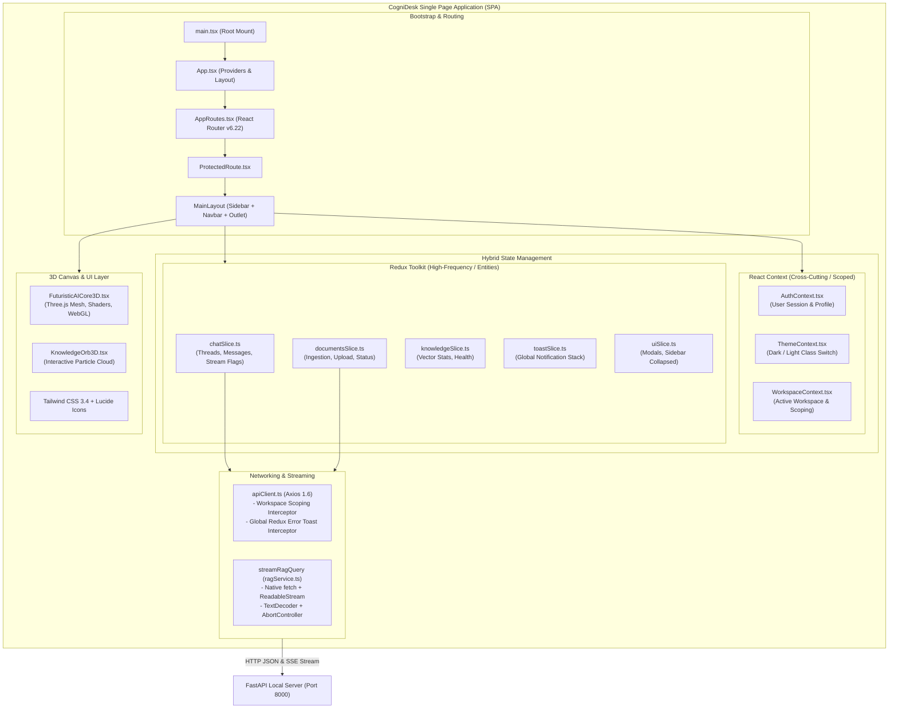

# COGNIDESK: THE ULTIMATE FRONTEND INTERVIEW GUIDE
> **Comprehensive Questions, Architectural Deep-Dives, Code Patterns & Senior Defense Framework**  
> *Target Roles: Senior Frontend Engineer, React/TypeScript Developer, Full-Stack Frontend Lead, WebGL/AI UI Specialist*

---

## TABLE OF CONTENTS
1. [CogniDesk Frontend Architecture & Technology Stack](#1-cognidesk-frontend-architecture--technology-stack)
2. [Category 1: Core Architecture, Build Tooling & TypeScript (Q1 – Q10)](#category-1-core-architecture-build-tooling--typescript-q1--q10)
3. [Category 2: State Management: Redux Toolkit vs. React Context (Q11 – Q20)](#category-2-state-management-redux-toolkit-vs-react-context-q11--q20)
4. [Category 3: Real-Time LLM Streaming & Network Architecture (Q21 – Q30)](#category-3-real-time-llm-streaming--network-architecture-q21--q30)
5. [Category 4: Three.js, WebGL & 3D Interactive Visualizations (Q31 – Q40)](#category-4-threejs-webgl--3d-interactive-visualizations-q31--q40)
6. [Category 5: UI/UX, Component Architecture & Tailwind CSS (Q41 – Q50)](#category-5-uiux-component-architecture--tailwind-css-q41--q50)
7. [Category 6: Performance Optimization & React 18 Concurrency (Q51 – Q60)](#category-6-performance-optimization--react-18-concurrency-q51--q60)
8. [Category 7: Security, Offline-First Resilience & Error Handling (Q61 – Q70)](#category-7-security-offline-first-resilience--error-handling-q61--q70)
9. [Category 8: Practical Live Coding & Debugging Challenges (Challenge 1 – 5)](#category-8-practical-live-coding--debugging-challenges)
10. [Senior vs. Junior Answer Comparison Matrix](#senior-vs-junior-answer-comparison-matrix)

---

## 1. COGNIDESK FRONTEND ARCHITECTURE & TECHNOLOGY STACK



### Key Technical Specs
- **Library/Framework**: [React 18.2.0](https://react.dev/) + [TypeScript 5.2.2](https://www.typescriptlang.org/)
- **Bundler & Tooling**: [Vite 5.1.4](https://vitejs.dev/) with `@vitejs/plugin-react`
- **State Store**: [@reduxjs/toolkit 2.2.1](https://redux-toolkit.js.org/) + [react-redux 9.1.0](https://react-redux.js.org/)
- **Routing**: [react-router-dom 6.22.2](https://reactrouter.com/) (Data routing, nested routes, client-side guards)
- **Styling**: [Tailwind CSS 3.4.1](https://tailwindcss.com/) + `clsx` + `tailwind-merge`
- **3D Graphics**: [Three.js 0.186.0](https://threejs.org/) with typed shaders and parametric geometries
- **HTTP Client**: [Axios 1.6.8](https://axios-http.com/) (Interceptors, timeouts, cancellation tokens)
- **Streaming Protocol**: Native `fetch` + `ReadableStreamDefaultReader` + `TextDecoder` for Server-Sent Events (SSE)

---

## CATEGORY 1: CORE ARCHITECTURE, BUILD TOOLING & TYPESCRIPT (Q1 – Q10)

### Q1: Why was Vite chosen over Create React App (CRA) or Next.js for CogniDesk?
- **Strong Technical Answer**: 
  1. **Offline Desktop Footprint**: CogniDesk is an on-device local AI desktop platform. Next.js introduces Node.js SSR/Edge runtime overhead, unnecessary server rendering passes, and bundle bloat when packaged with Tauri or Electron.
  2. **Sub-second HMR via Native ES Modules**: CRA uses Webpack, which bundles the entire AST before serving. Vite leverages browser-native ESM (`<script type="module">`) and `esbuild` for pre-bundling dependencies in Go, providing instant startup (<300ms) and millisecond HMR regardless of project size.
  3. **Zero SSR Hydration Mismatches**: With complex client-only libraries like Three.js (`window.WebGLRenderingContext`, `document.createElement('canvas')`), SSR frameworks produce hydration mismatch warnings (`window is not defined`). Vite builds a pure static client bundle (`tsc && vite build`) that is trivially served via FastAPI's `StaticFiles` or packaged into a desktop shell.
- **Beginner Explanation**: CRA is like an old diesel truck that takes minutes to warm up. Next.js is a massive freight train designed for internet web servers. Vite is a lightweight electric sports car that turns on instantly and runs directly in the user's browser without needing a cloud server.
- **Key Takeaway**: Local-first offline apps need static compilation, zero SSR overhead, and instant developer iteration.
- **Interviewer Follow-up**: *How does Vite handle environment variables differently than CRA?*
- **Follow-up Answer**: *Vite exposes environment variables on `import.meta.env` (e.g., `import.meta.env.VITE_API_BASE_URL`) rather than `process.env.REACT_APP_*`. Variables must be prefixed with `VITE_` to prevent leaking private system secrets into the client bundle.*

---

### Q2: Walk me through the entry point and lifecycle of CogniDesk's frontend.
- **Strong Technical Answer**: 
  The application boots at [`main.tsx`](file:///c:/Users/himan/Downloads/CogniDesk/frontend/src/main.tsx):
  1. `ReactDOM.createRoot(document.getElementById('root')!)` initializes React 18's concurrent root.
  2. The root tree is wrapped with `React.StrictMode` and Redux's `<Provider store={store}>`.
  3. Control shifts to [`App.tsx`](file:///c:/Users/himan/Downloads/CogniDesk/frontend/src/App.tsx), which constructs a nested provider tree: `ThemeProvider` -> `AuthProvider` -> `WorkspaceProvider` -> `BrowserRouter`.
  4. Global overlays are mounted: `<ToastContainer />` for notifications and `<SearchModal />` for quick navigation.
  5. The routing engine [`AppRoutes.tsx`](file:///c:/Users/himan/Downloads/CogniDesk/frontend/src/routes/AppRoutes.tsx) executes route evaluation, routing through [`ProtectedRoute.tsx`](file:///c:/Users/himan/Downloads/CogniDesk/frontend/src/routes/ProtectedRoute.tsx) and rendering [`MainLayout.tsx`](file:///c:/Users/himan/Downloads/CogniDesk/frontend/src/components/layout/MainLayout.tsx).
- **Beginner Explanation**: Just like starting a car, `main.tsx` turns the ignition key, loads the global battery (Redux store), adjusts the mirrors and seat (Context providers for theme, user, and workspace), and then puts the car in gear (React Router).
- **Key Takeaway**: Provider ordering is deliberate: Redux is outermost so custom contexts and services can access state if needed; Theme and Workspace wrap the Router.
- **Interviewer Follow-up**: *Why run `React.StrictMode` in development if it causes `useEffect` to execute twice?*
- **Follow-up Answer**: *`StrictMode` intentionally double-invokes effects in dev to detect unhandled memory leaks, missing event-listener cleanup functions, and non-idempotent side effects—which is critical for Three.js WebGL renderers and SSE connections.*

---

### Q3: How is TypeScript strictly leveraged across CogniDesk's codebase?
- **Strong Technical Answer**:
  TypeScript is configured with `strict: true` in `tsconfig.json`. The codebase avoids `any` types by enforcing strict interface contracts:
  - **Relational & RAG Models**: `ChatMessageItem`, `ChatThreadItem`, `RagCitation`, `DocumentItem`, and `WorkspaceItem`.
  - **Discriminated Unions**: For message roles (`sender: 'user' | 'assistant'`) and document ingestion states:
    ```typescript
    export interface DocumentItem {
      id: string;
      name: string;
      size: string;
      type: string;
      status: 'Indexed' | 'Processing' | 'Processed' | 'Uploaded' | 'Failed';
      date: string;
      chunks: number;
    }
    ```
  - **Typed Redux Slices**: Payload actions are strongly typed via `PayloadAction<T>`, ensuring reducers reject mismatched dispatch arguments at compile time.
  - **Typed Hooks**: Custom hooks [`useAppDispatch`](file:///c:/Users/himan/Downloads/CogniDesk/frontend/src/hooks/useRedux.ts) and [`useAppSelector`](file:///c:/Users/himan/Downloads/CogniDesk/frontend/src/hooks/useRedux.ts) use `TypedUseSelectorHook<RootState>`.
- **Beginner Explanation**: TypeScript acts like a spell-checker for code. If you try to pass an "apples" data shape into a function that expects "oranges", the code won't compile, preventing runtime crashes before the user even opens the app.
- **Key Takeaway**: Strong type safety prevents silent runtime bugs during complex asynchronous API transformations and RAG chunk mapping.
- **Interviewer Follow-up**: *What is the difference between `interface` and `type` in your application?*
- **Follow-up Answer**: *We use `interface` for object schemas, API responses, and Redux state (allowing declaration merging and clean extension via `extends`), and `type` for unions, primitives, and mapped utility types.*

---

### Q4: How is routing designed, and how do Protected Routes work in React Router v6?
- **Strong Technical Answer**:
  CogniDesk uses React Router DOM v6 nested layout routes. In [`AppRoutes.tsx`](file:///c:/Users/himan/Downloads/CogniDesk/frontend/src/routes/AppRoutes.tsx):
  ```tsx
  <Routes>
    <Route element={<ProtectedRoute />}>
      <Route path="/" element={<MainLayout />}>
        <Route index element={<DashboardPage />} />
        <Route path="chat" element={<ChatPage />} />
        <Route path="documents" element={<DocumentsPage />} />
        ...
        <Route path="*" element={<Navigate to="/" replace />} />
      </Route>
    </Route>
  </Routes>
  ```
  [`ProtectedRoute.tsx`](file:///c:/Users/himan/Downloads/CogniDesk/frontend/src/routes/ProtectedRoute.tsx) consumes `useAuth()`. If `isAuthenticated` is `false`, it returns `<Navigate to="/login" replace />`. Otherwise, it renders `<Outlet />`, which passes control to [`MainLayout.tsx`](file:///c:/Users/himan/Downloads/CogniDesk/frontend/src/components/layout/MainLayout.tsx).
- **Beginner Explanation**: The protected route is like a security guard at the building entrance. If you don't have a badge, it redirects you to the front desk. If you do, it opens the door to the office layout.
- **Key Takeaway**: Nested layout routes avoid duplicating the sidebar and navbar across every page view.
- **Interviewer Follow-up**: *Why use `<Navigate replace />` instead of normal navigation?*
- **Follow-up Answer**: *`replace` replaces the current entry in the browser's history stack so the user cannot click the browser's "Back" button to return to an unauthorized page.*

---

### Q5: How does CogniDesk structure its folder hierarchy for scale?
- **Strong Technical Answer**:
  The codebase follows a modular, feature-cohesive structure:
  - `src/components/`: Reusable presentation components grouped by domain (`3d/`, `dashboard/`, `layout/`, `ui/`).
  - `src/pages/`: Route-level views (`ChatPage`, `DocumentsPage`, `KnowledgeBasePage`, `FlashcardsPage`).
  - `src/context/`: Scoped React Contexts (`AuthContext`, `ThemeContext`, `WorkspaceContext`).
  - `src/store/`: Centralized Redux store configuration and domain slices (`chatSlice`, `documentsSlice`, `toastSlice`).
  - `src/services/`: Isolated API clients and HTTP layer (`apiClient`, `ragService`, `documentService`).
  - `src/hooks/`: Custom reusable hooks (`useRedux`, `useAsync`, `useToast`).
- **Beginner Explanation**: Instead of throwing all files into one junk drawer, we organize files into labeled drawers based on their job—visual components, pages, network calls, and data storage.
- **Key Takeaway**: Separation of concerns: components do not make direct Axios calls; they delegate to services and dispatch to Redux or Context.

---

### Q6: How does the application handle global environment variables and backend URLs?
- **Strong Technical Answer**:
  In [`apiClient.ts`](file:///c:/Users/himan/Downloads/CogniDesk/frontend/src/services/apiClient.ts) and [`ragService.ts`](file:///c:/Users/himan/Downloads/CogniDesk/frontend/src/services/ragService.ts):
  ```typescript
  const API_BASE_URL = import.meta.env.VITE_API_BASE_URL || 'http://127.0.0.1:8000/api/v1';
  ```
  Vite loads values from `.env` and `.env.production`. For desktop builds (e.g., Tauri or Electron), the base URL points to `http://127.0.0.1:8000/api/v1`, targeting the locally spawned Python backend process.
- **Beginner Explanation**: It's a configurable address book. By default, the frontend talks to port 8000 on your local machine, but if the backend runs on a different port, you only change one line in `.env`.
- **Key Takeaway**: Fallback defaults ensure the project runs immediately after `npm run dev` without requiring manual `.env` file creation.

---

### Q7: What is the purpose of `tailwind-merge` and `clsx` in CogniDesk?
- **Strong Technical Answer**:
  Standard string concatenation of Tailwind classes often results in conflicting CSS properties (e.g., `px-4 px-6`). 
  CogniDesk uses `clsx` for conditional class application (`clsx('base-class', isActive && 'active-class')`) combined with `tailwind-merge` (`twMerge`), which resolves Tailwind utility conflicts by respecting the cascade order:
  ```typescript
  export function cn(...inputs: ClassValue[]) {
    return twMerge(clsx(inputs));
  }
  ```
- **Beginner Explanation**: If you tell a component to be both "padding 4" and "padding 6", regular CSS gets confused. `twMerge` intelligently recognizes they are the same property and overrides it with the newer value.
- **Key Takeaway**: Prevents style inheritance bugs in reusable design system components.

---

### Q8: How is the build bundle optimized for production?
- **Strong Technical Answer**:
  1. **Tree-Shaking**: Vite uses Rollup under the hood, statically analyzing ES6 `import`/`export` statements to eliminate dead code.
  2. **Code Splitting**: Dynamic imports (`React.lazy(() => import('./pages/ChatPage'))`) can split heavy pages into isolated JS chunks, loading them only when the route is visited.
  3. **Asset Compression & Chunking**: Three.js is a large dependency (~600KB uncompressed). In Vite's `manualChunks` config, Three.js can be split into a dedicated vendor chunk to maximize browser cache longevity.
- **Beginner Explanation**: Instead of forcing the browser to download a huge 5MB file when opening the home page, the bundler slices it into small pieces and downloads only what is needed right now.
- **Key Takeaway**: Fast initial page load (FCP) and optimal caching of unchanged vendor libraries.

---

### Q9: How are icons handled to minimize bundle size?
- **Strong Technical Answer**:
  CogniDesk imports icons specifically from `lucide-react` using named imports:
  ```typescript
  import { MessageSquare, FileText, Database, Settings } from 'lucide-react';
  ```
  Because `lucide-react` publishes ES modules with `sideEffects: false`, bundlers tree-shake unused icons, including only the SVG path data for the 25 icons actually used in CogniDesk rather than all 1,000+ icons.
- **Beginner Explanation**: Rather than carrying an entire encyclopedia of symbols, we only pack the 20 symbols our app actually uses.
- **Key Takeaway**: Named ESM imports guarantee tree-shaking and keep the bundle under 200KB.

---

### Q10: How does CogniDesk ensure accessibility (a11y) across interactive elements?
- **Strong Technical Answer**:
  1. Semantic HTML tags (`<nav>`, `<main>`, `<aside>`, `<header>`, `<button>`).
  2. Decorative 3D Three.js canvas containers are explicitly hidden from screen readers using `aria-hidden="true"`.
  3. Interactive icon-only buttons include descriptive `aria-label` attributes (e.g., `aria-label="Send query"`, `aria-label="Toggle dark mode"`).
  4. Respects `prefers-reduced-motion` media queries in Three.js animations, downscaling rotation speeds to prevent vestibular discomfort.
- **Beginner Explanation**: Making sure people using screen readers or keyboard navigation can use the app smoothly, and preventing 3D animations from causing dizziness.
- **Key Takeaway**: Modern frontend standards require accessibility even in cutting-edge AI and 3D visual dashboards.

---

## CATEGORY 2: STATE MANAGEMENT: REDUX TOOLKIT VS. REACT CONTEXT (Q11 – Q20)

### Q11: Why does CogniDesk use BOTH Redux Toolkit and React Context? Why not just one?
- **Strong Technical Answer**:
  This is a conscious architectural separation between **High-Frequency Relational Entity State** and **Cross-Cutting Environmental/Session State**:
  - **React Context** (`AuthContext`, `ThemeContext`, `WorkspaceContext`):
    - Ideal for low-frequency global values that rarely change (e.g., active theme, logged-in user profile, current workspace ID).
    - Lightweight, requires zero boilerplate, and natively integrates with React's component tree.
  - **Redux Toolkit** (`chatSlice`, `documentsSlice`, `knowledgeSlice`, `toastSlice`):
    - Ideal for high-frequency, complex relational mutations (e.g., appending streaming tokens to chat messages, tracking upload percentages, updating multi-document ingestion statuses).
    - Redux selector memoization (`useAppSelector`) prevents unnecessary re-renders across the entire component tree. If chat tokens were kept in React Context, every new token would re-render the entire app tree wrapped by that context.
- **Beginner Explanation**: React Context is like the building's thermostat—everyone needs to know the temperature, but it only changes once in a while. Redux is like the stock ticker—numbers are flying by every millisecond, and you only want the specific screen displaying that stock to update.
- **Key Takeaway**: Context for environment/session; Redux for fast, granular, selector-driven entity state.
- **Interviewer Follow-up**: *What would happen if you put the active chat streaming text into `WorkspaceContext`?*
- **Follow-up Answer**: *Every token emitted by the LLM would trigger a Context value update, causing every component consuming that Context (Sidebar, Navbar, Workspace selector, Document tables) to re-render 30 times a second, completely freezing the UI.*

---

### Q12: Walk me through the structure of `chatSlice.ts`.
- **Strong Technical Answer**:
  In [`chatSlice.ts`](file:///c:/Users/himan/Downloads/CogniDesk/frontend/src/store/slices/chatSlice.ts), the state is defined as:
  ```typescript
  interface ChatState {
    threads: ChatThread[];
    activeThreadId: string;
    selectedModel: string;
    isStreaming: boolean;
  }
  ```
  Key reducers:
  - `setActiveThreadId`: Switches the current conversation view.
  - `setSelectedModel`: Changes active LLM (`qwen2.5:3b`, `llama3`).
  - `setIsStreaming`: Toggles the streaming spinner and disables send buttons.
  - `addMessageToThread`: Pushes user or assistant messages into the active thread.
  - `createNewThread`: Creates a blank thread and sets it as active.
  Redux Toolkit uses **Immer** under the hood, allowing developers to write direct mutations (`state.threads.unshift(newThread)`) while safely generating immutable state snapshots.
- **Beginner Explanation**: It manages your chat history like an email inbox: an active email you are reading, a list of old emails on the side, and a flag indicating whether you are currently sending or receiving.
- **Key Takeaway**: Immer in Redux Toolkit eliminates tedious manual object spread operations (`...state, threads: [...state.threads]`).

---

### Q13: How does `documentsSlice.ts` handle document ingestion state?
- **Strong Technical Answer**:
  In [`documentsSlice.ts`](file:///c:/Users/himan/Downloads/CogniDesk/frontend/src/store/slices/documentsSlice.ts):
  - Tracks `items: DocumentItem[]`, `searchTerm: string`, `selectedType: string | null`, `isUploading: boolean`, and `uploadProgress: number`.
  - The `updateDocument` reducer locates a document by its ID and updates its status (`'Uploaded'` -> `'Processing'` -> `'Indexed'` or `'Failed'`).
  - Enables optimistic UI updates: when a user clicks "Upload", an item is immediately added to Redux with status `'Uploaded'`, and replaced or updated once the backend finishes chunking and ChromaDB vector indexing.
- **Beginner Explanation**: As a document moves from your hard drive to the server, then gets read by OCR, and finally saved in the vector database, this slice updates its progress badge from "Uploading" to "Indexed".
- **Key Takeaway**: Centralized tracking of asynchronous multi-step document pipelines.

---

### Q14: How does `WorkspaceContext.tsx` synchronize state when a user switches workspaces?
- **Strong Technical Answer**:
  In [`WorkspaceContext.tsx`](file:///c:/Users/himan/Downloads/CogniDesk/frontend/src/context/WorkspaceContext.tsx):
  ```typescript
  const switchWorkspace = async (id: number): Promise<boolean> => {
    setLoading(true);
    const activated = await activateWorkspaceApi(id);
    setActiveWorkspace(activated);
    localStorage.setItem('cognidesk_active_workspace_id', String(activated.id));
    
    const updatedList = await getWorkspaces();
    setWorkspaces(updatedList);

    // Global custom event notification
    window.dispatchEvent(new CustomEvent('workspace-switched', { detail: activated }));
    setLoading(false);
    return true;
  };
  ```
  1. Calls backend to mark workspace active in SQLite.
  2. Updates local state and persists `cognidesk_active_workspace_id` to `localStorage` (used by Axios request interceptors).
  3. Dispatches a custom DOM event `workspace-switched` so decoupled pages can listen and refresh their localized data immediately.
- **Beginner Explanation**: When you switch from "Medical Project" to "Legal Project", the workspace manager saves your new choice, tells the backend, and sounds a horn (`CustomEvent`) so all open pages instantly clear the old files and reload the new ones.
- **Key Takeaway**: Multi-tenant data scoping enforced seamlessly at the frontend layer.
- **Interviewer Follow-up**: *Why dispatch a `CustomEvent` instead of using a Redux action?*
- **Follow-up Answer**: *`WorkspaceContext` was designed as a standalone provider. Using a window `CustomEvent` allows completely decoupled components or external event listeners to react without introducing a circular dependency between Redux slices and Context.*

---

### Q15: How does the Toast notification system work across the frontend?
- **Strong Technical Answer**:
  - The state is managed in [`toastSlice.ts`](file:///c:/Users/himan/Downloads/CogniDesk/frontend/src/store/slices/toastSlice.ts) with an array of `ToastItem` (`{ id, type: 'success' | 'error' | 'info' | 'warning', title, message, duration }`).
  - Rendered by [`ToastContainer.tsx`](file:///c:/Users/himan/Downloads/CogniDesk/frontend/src/components/ui/ToastContainer.tsx) placed at the app root.
  - Crucially, [`apiClient.ts`](file:///c:/Users/himan/Downloads/CogniDesk/frontend/src/services/apiClient.ts) imports `store` directly and dispatches `addToast` in its Axios response interceptor whenever a network error or 500 status code occurs.
- **Beginner Explanation**: If any API call fails anywhere in the app, the error handler automatically pops up a clean red banner in the top corner without having to write `try/catch` UI alerts in every component.
- **Key Takeaway**: Non-React files (like Axios interceptor modules) can dispatch actions directly to `store.dispatch()`.

---

### Q16: How do you prevent unnecessary re-renders when using `useAppSelector`?
- **Strong Technical Answer**:
  1. **Fine-Grained Selectors**: Instead of selecting the entire slice (`const chat = useAppSelector(state => state.chat)`), select only the primitive or sub-property needed:
     ```typescript
     const isStreaming = useAppSelector((state) => state.chat.isStreaming);
     ```
  2. **Equality Comparison**: Redux compares previous and next selector returns using strict reference equality (`===`).
  3. **Reselect Memoization**: For derived or filtered arrays (e.g., filtering indexed documents), use `createSelector` from Redux Toolkit to prevent returning a new array reference on every render.
- **Beginner Explanation**: Don't order the entire grocery store if you only need a carton of milk. If you only watch for `isStreaming`, your component won't re-render when a new message is typed.
- **Key Takeaway**: Primitive selectors and memoized selectors are the primary defense against React re-render lag.

---

### Q17: What custom hooks are implemented in CogniDesk and why?
- **Strong Technical Answer**:
  1. [`useRedux.ts`](file:///c:/Users/himan/Downloads/CogniDesk/frontend/src/hooks/useRedux.ts): Exposes pre-typed `useAppDispatch` and `useAppSelector`.
  2. [`useAsync.ts`](file:///c:/Users/himan/Downloads/CogniDesk/frontend/src/hooks/useAsync.ts): Generic hook encapsulating `execute`, `loading`, `error`, and `data` states for one-off promises.
  3. [`useToast.ts`](file:///c:/Users/himan/Downloads/CogniDesk/frontend/src/hooks/useToast.ts): Syntactic sugar wrapping `dispatch(addToast(...))` with convenience methods (`success()`, `error()`, `warning()`, `info()`).
- **Beginner Explanation**: Custom hooks package repetitive logic into clean, reusable single-line commands so components remain short and focused on their visual markup.
- **Key Takeaway**: Encapsulates Redux and async state boilerplate out of view components.

---

### Q18: What is the risk of prop drilling in a project like CogniDesk, and how is it eliminated?
- **Strong Technical Answer**:
  In a complex dashboard (Sidebar, Header, Main Canvas, Document Cards, Floating Chat), passing the active workspace or user profile down 5 levels of props creates rigid coupling and boilerplate.
  CogniDesk eliminates prop drilling via:
  - Context consumers (`useWorkspace()`, `useAuth()`, `useTheme()`).
  - Redux hooks (`useAppSelector(state => state.chat)`).
  Components fetch their own scoped data directly from the state layer.
- **Beginner Explanation**: Instead of passing a letter by hand through 5 intermediate people, the component picks up the phone and calls the central database directly.
- **Key Takeaway**: Clean component signatures and decoupled refactoring.

---

### Q19: How is Redux DevTools configured, and what are the security considerations?
- **Strong Technical Answer**:
  Redux Toolkit's `configureStore` enables Redux DevTools by default in development (`devTools: process.env.NODE_ENV !== 'production'`). In an enterprise offline desktop app handling confidential documents, leaving DevTools active in production bundles allows users or third-party browser extensions to inspect vector chunk texts and sensitive document metadata directly from memory.
- **Beginner Explanation**: DevTools lets developers peek behind the curtain. In production, we close that window so private files aren't exposed in browser inspection tools.
- **Key Takeaway**: Disable DevTools or sanitize sensitive action payloads in production builds.

---

### Q20: How does `ThemeContext.tsx` handle Dark/Light mode without UI flickering?
- **Strong Technical Answer**:
  In [`ThemeContext.tsx`](file:///c:/Users/himan/Downloads/CogniDesk/frontend/src/context/ThemeContext.tsx):
  1. Reads initial preference from `localStorage.getItem('cognidesk_theme')` or falls back to system preference `window.matchMedia('(prefers-color-scheme: dark)').matches`.
  2. Directly toggles the `'dark'` class on `document.documentElement` (`<html class="dark">`).
  3. Tailwind's `darkMode: 'class'` selector automatically updates all `dark:...` color rules across the DOM in a single browser paint frame, preventing visual flash of unstyled content (FOUC).
- **Beginner Explanation**: When the app starts, it checks your saved theme preference and sticks a `dark` label on the top-level HTML element before painting the screen, so you never get blinded by a bright white flash.
- **Key Takeaway**: Class-based theme toggling is instant and hardware-accelerated via CSS variables.

---

## CATEGORY 3: REAL-TIME LLM STREAMING & NETWORK ARCHITECTURE (Q21 – Q30)

### Q21: Why does CogniDesk use native `fetch` + `ReadableStream` instead of Axios for LLM streaming?
- **Strong Technical Answer**:
  While Axios 1.x supports streaming in Node.js via HTTP adapters, its browser implementation has historical limitations with Server-Sent Events (SSE) and chunk-by-chunk HTTP response streaming without buffering.
  Native browser `fetch` provides direct, low-level access to the `ReadableStream` API via `response.body.getReader()`. This allows CogniDesk to:
  1. Read raw binary chunks (`Uint8Array`) as they arrive over the TCP socket.
  2. Decode them on-the-fly using `TextDecoder`.
  3. Parse SSE lines immediately without waiting for the full response payload to finish downloading.
- **Beginner Explanation**: Axios is great at downloading complete packages, but for an AI chat that prints word-by-word like a typewriter, native `fetch` gives us direct access to the incoming wire stream so words show up the millisecond the LLM produces them.
- **Key Takeaway**: Native `fetch` + `ReadableStream` is the industry standard for client-side LLM streaming.
- **Interviewer Follow-up**: *Could you use `EventSource` instead of `fetch` for SSE?*
- **Follow-up Answer**: *Standard browser `EventSource` only supports `GET` requests and cannot send a `POST` body or custom headers. CogniDesk's RAG query requires a `POST` request containing a large JSON payload (user query, active document IDs, selected model, chat history, top_k parameters).*

---

### Q22: Walk me through the exact line-by-line mechanics of `streamRagQuery` in `ragService.ts`.
- **Strong Technical Answer**:
  From [`ragService.ts`](file:///c:/Users/himan/Downloads/CogniDesk/frontend/src/services/ragService.ts):
  ```typescript
  export const streamRagQuery = (payload, onMetadata, onToken, onDone, onError) => {
    const controller = new AbortController();

    fetch(`${API_BASE_URL}/rag/stream`, {
      method: 'POST',
      headers: { 'Content-Type': 'application/json', 'X-CogniDesk-Client': 'WebUI-v1.0' },
      body: JSON.stringify(payload),
      signal: controller.signal,
    }).then(async (res) => {
      const reader = res.body.getReader();
      const decoder = new TextDecoder();
      let buffer = '';

      while (true) {
        const { value, done } = await reader.read();
        if (done) break;

        buffer += decoder.decode(value, { stream: true });
        const lines = buffer.split('\n\n');
        buffer = lines.pop() || ''; // Preserve incomplete trailing chunk

        for (const line of lines) {
          if (line.startsWith('data: ')) {
            const jsonStr = line.replace(/^data: /, '').trim();
            if (!jsonStr) continue;
            const parsed = JSON.parse(jsonStr);
            if (parsed.type === 'metadata') onMetadata(parsed);
            else if (parsed.type === 'token') onToken(parsed.token);
            else if (parsed.type === 'done') onDone();
          }
        }
      }
      onDone();
    }).catch(err => {
      if (err.name !== 'AbortError') onError(err);
    });

    return () => controller.abort();
  };
  ```
  1. `AbortController` is instantiated to allow client cancellation.
  2. `reader.read()` asynchronously yields chunks.
  3. `buffer.split('\n\n')` handles network packet fragmentation where an SSE message might be split across two TCP packets. `buffer = lines.pop()` retains incomplete data for the next chunk.
  4. Parses JSON payloads, dispatching tokens to `onToken` and citations/model info to `onMetadata`.
- **Beginner Explanation**: It acts like an assembly line: pieces of words arrive in chunks, a decoder translates them into text, splits them at empty lines, checks if each piece has a "data: " tag, turns it into a real object, and hands each letter to the chat screen.
- **Key Takeaway**: Retaining `buffer = lines.pop()` prevents `JSON.parse` crashes from truncated network packets.

---

### Q23: How do you handle stream cancellation when the user clicks "Stop Generation" or navigates away?
- **Strong Technical Answer**:
  `streamRagQuery` returns a cleanup function: `() => controller.abort()`.
  In `ChatPage.tsx`:
  1. The abort function is stored in a ref: `abortStreamRef.current = streamRagQuery(...)`.
  2. When the user clicks the "Stop" button: `abortStreamRef.current?.()`.
  3. In `useEffect` cleanup when unmounting the page:
     ```typescript
     useEffect(() => {
       return () => {
         abortStreamRef.current?.();
       };
     }, []);
     ```
  4. When aborted, `fetch` throws a DOMException `AbortError`, which is caught and ignored (`if (err.name !== 'AbortError') onError(err)`), cleanly terminating the TCP connection and telling FastAPI to cancel Ollama generation.
- **Beginner Explanation**: Like hanging up a telephone call. If the user leaves the room or hits "Stop", we drop the line immediately so the computer stops wasting electricity generating words no one will read.
- **Key Takeaway**: Always clean up active streams on component unmount to prevent state updates on unmounted components and memory leaks.

---

### Q24: How does Axios handle workspace isolation via Request Interceptors in `apiClient.ts`?
- **Strong Technical Answer**:
  In [`apiClient.ts`](file:///c:/Users/himan/Downloads/CogniDesk/frontend/src/services/apiClient.ts):
  ```typescript
  apiClient.interceptors.request.use((config) => {
    config.headers['X-CogniDesk-Client'] = 'WebUI-v1.0';
    const activeWsId = localStorage.getItem('cognidesk_active_workspace_id');
    if (activeWsId) {
      config.headers['X-Workspace-Id'] = activeWsId;
    }
    if (config.data instanceof FormData) {
      delete config.headers['Content-Type']; // Let browser set boundary
    } else if (!config.headers['Content-Type']) {
      config.headers['Content-Type'] = 'application/json';
    }
    return config;
  });
  ```
  Every outgoing API call automatically attaches the active workspace ID header. The FastAPI backend extracts `X-Workspace-Id` to filter SQLite queries and ChromaDB vector metadata, completely abstracting workspace scoping away from individual frontend service methods.
- **Beginner Explanation**: Like an automatic postal stamp. Before any letter leaves the mailroom, the interceptor stamps it with the active department ID so the receiving office knows exactly which folder to open.
- **Key Takeaway**: Developers don't have to manually append `?workspace_id=...` to dozens of API endpoints.

---

### Q25: Why is `delete config.headers['Content-Type']` necessary when uploading `FormData` in Axios?
- **Strong Technical Answer**:
  When sending multipart file uploads (`FormData`), the browser must automatically set the `Content-Type` header to include the unique MIME boundary parameter:
  `Content-Type: multipart/form-data; boundary=----WebKitFormBoundary7MA4YWxkTrZu0gW`.
  If an Axios client has a default `headers['Content-Type'] = 'application/json'`, or if a developer manually sets `'multipart/form-data'`, the boundary parameter is omitted. The backend server (FastAPI/Starlette) fails to parse the multipart stream and throws a `422 Unprocessable Entity` or `400 Bad Request`. Deleting the header forces the browser to generate the boundary automatically.
- **Beginner Explanation**: File uploads need a special boundary code to tell where one file ends and the next begins. If you force the header manually, that code is missing and the server rejects the upload.
- **Key Takeaway**: Never hardcode `'Content-Type': 'multipart/form-data'` in Axios; let the browser generate it with its boundary.

---

### Q26: How does global error handling work in `apiClient.ts` via Response Interceptors?
- **Strong Technical Answer**:
  In [`apiClient.ts`](file:///c:/Users/himan/Downloads/CogniDesk/frontend/src/services/apiClient.ts):
  ```typescript
  apiClient.interceptors.response.use(
    (response) => response,
    (error) => {
      const errorMessage =
        error.response?.data?.error?.message ||
        error.response?.data?.detail ||
        error.message ||
        'An unexpected network error occurred';

      store.dispatch(
        addToast({
          type: 'error',
          title: 'API Request Error',
          message: errorMessage,
        })
      );
      return Promise.reject(error);
    }
  );
  ```
  Any HTTP 4xx/5xx or network dropout is intercepted. The error message is extracted and dispatched to Redux's `toastSlice`, surfacing a notification to the user without requiring `try/catch` toast boilerplate in every UI component.
- **Beginner Explanation**: A centralized safety net. If a wire snaps or a server throws an error, the interceptor catches it and displays an alert box, while still letting the calling function know it failed.
- **Key Takeaway**: Centralized error presentation decoupled from UI view logic.

---

### Q27: How does CogniDesk display citations and source verification in the chat UI?
- **Strong Technical Answer**:
  When `streamRagQuery` receives the `{ type: 'metadata' }` packet, it includes a `citations: RagCitation[]` array:
  ```typescript
  export interface RagCitation {
    docName: string;
    page: string;
    score: string;
    documentId?: number;
    similarityScore?: number;
  }
  ```
  In the message bubble, citations are rendered as interactive badges (e.g., `📄 Annual_Report.pdf (p. 4, score: 0.89)`). Clicking a citation can trigger a document preview modal or jump to the document in `DocumentsPage`.
- **Beginner Explanation**: Beside the AI's answer, it attaches small footnote tags showing the exact document name, page number, and similarity score so the user can verify the facts.
- **Key Takeaway**: Grounded RAG with transparent citations builds enterprise trust and eliminates hallucination panic.

---

### Q28: How is file upload progress tracked and animated in the UI?
- **Strong Technical Answer**:
  In `documentService.ts`, Axios's `onUploadProgress` config callback is utilized:
  ```typescript
  export const uploadDocument = async (file: File, onProgress?: (percent: number) => void) => {
    const formData = new FormData();
    formData.append('file', file);
    return apiClient.post('/documents/upload', formData, {
      onUploadProgress: (progressEvent) => {
        if (progressEvent.total) {
          const percent = Math.round((progressEvent.loaded * 100) / progressEvent.total);
          onProgress?.(percent);
          store.dispatch(setUploadProgress(percent));
        }
      },
    });
  };
  ```
  This updates `uploadProgress` in Redux, which drives a smooth CSS width transition on a progress bar in `DocumentsPage`.
- **Beginner Explanation**: As bytes are pushed across the wire, Axios calculates what fraction of the file has arrived, updating a progress bar from 0% to 100%.
- **Key Takeaway**: Real-time feedback for large multi-megabyte PDF and OCR image uploads.

---

### Q29: What is the difference between polling, WebSockets, and SSE? Why was SSE chosen for RAG?
- **Strong Technical Answer**:
  - **Polling**: Client repeatedly asks "Are you done yet?" every second. High HTTP handshake overhead, latency, and wasted server CPU cycles.
  - **WebSockets**: Full-duplex bidirectional TCP socket. Excellent for games and peer-to-peer chat, but introduces complex stateful server connection management, proxy/firewall traversal issues, and doesn't support standard HTTP authentication or request interceptors easily.
  - **Server-Sent Events (SSE)**: Unidirectional streaming over standard HTTP. Perfect for LLM inference where the client sends one prompt (`POST`) and the server streams back tokens continuously. SSE operates over standard HTTP/1.1 and HTTP/2, supports standard status codes, and requires zero custom socket servers.
- **Beginner Explanation**: Polling is repeatedly knocking on a door. WebSockets is installing an intercom system. SSE is tuning your radio to a station: you make one request, and the station streams music to you until the song ends.
- **Key Takeaway**: SSE is lightweight, stateless on the server, and the natural match for generative LLM token streams.

---

### Q30: How does the frontend handle token streaming errors mid-sentence?
- **Strong Technical Answer**:
  If the local Ollama process runs out of VRAM or crashes mid-generation:
  1. The `ReadableStream` reader throws an exception during `await reader.read()`.
  2. The `catch` block catches the network interruption.
  3. It calls the `onError` callback passed to `streamRagQuery`.
  4. The UI leaves the already-streamed partial text in place, appends an inline error indicator (e.g., `[Generation interrupted: Ollama offline]`), and sets `isStreaming: false` so the user can regenerate or switch models.
- **Beginner Explanation**: If someone's microphone cuts out mid-sentence, you don't erase everything they just said. You keep what they said and show a "connection dropped" icon so the user can press "Retry".
- **Key Takeaway**: Preserves partial response context and gracefully unlocks the UI.

---

## CATEGORY 4: THREE.JS, WEBGL & 3D INTERACTIVE VISUALIZATIONS (Q31 – Q40)

### Q31: What is Three.js doing inside an AI Knowledge Workspace like CogniDesk?
- **Strong Technical Answer**:
  CogniDesk uses Three.js to provide hardware-accelerated WebGL visualizations that represent high-dimensional vector spaces and AI activity:
  - [`FuturisticAICore3D.tsx`](file:///c:/Users/himan/Downloads/CogniDesk/frontend/src/components/3d/FuturisticAICore3D.tsx): A multi-layered crystalline nucleus representing the local AI inference engine with interactive mouse parallax and rhythmic breathing animations.
  - [`KnowledgeOrb3D.tsx`](file:///c:/Users/himan/Downloads/CogniDesk/frontend/src/components/3d/KnowledgeOrb3D.tsx): Visualizes vector embeddings as a 3D orbital particle cloud with constellation lines, symbolizing semantic document clustering.
  - Elevates the user experience into a futuristic, premium desktop application while remaining performant on low-end hardware.
- **Beginner Explanation**: Instead of boring flat loading spinners, Three.js draws a 3D glowing holographic orb that spins and reacts to your mouse, making the local AI feel alive and state-of-the-art.
- **Key Takeaway**: Modern high-value enterprise apps use WebGL micro-visualizations to command user delight and premium positioning.

---

### Q32: Walk me through the lifecycle of a Three.js scene mounted inside a React component.
- **Strong Technical Answer**:
  Inside [`FuturisticAICore3D.tsx`](file:///c:/Users/himan/Downloads/CogniDesk/frontend/src/components/3d/FuturisticAICore3D.tsx):
  1. **Mounting**: A `mountRef = useRef<HTMLDivElement>(null)` anchors the canvas.
  2. **Scene & Camera Setup**:
     ```typescript
     const scene = new THREE.Scene();
     const camera = new THREE.PerspectiveCamera(45, 1, 0.1, 100);
     camera.position.z = 4.2;
     const renderer = new THREE.WebGLRenderer({ alpha: true, antialias: true });
     renderer.setSize(size, size);
     mountRef.current.appendChild(renderer.domElement);
     ```
  3. **Animation Loop**: An `animate` function is driven by `requestAnimationFrame(animate)`, updating mesh rotations based on elapsed time and rendering `renderer.render(scene, camera)`.
  4. **Unmounting / Cleanup**: The `useEffect` return function cancels the animation frame, removes the canvas from the DOM, and disposes of all geometries, materials, and textures.
- **Beginner Explanation**: React creates an empty frame on the screen. Three.js sets up a 3D stage, points a camera at it, adds lights and glowing shapes, and begins painting 60 frames a second. When the user leaves, it tears down the stage and cleans up the mess.
- **Key Takeaway**: React manages DOM structure; Three.js manages the WebGL imperative rendering pipeline inside that container.

---

### Q33: How do you prevent catastrophic WebGL memory leaks when unmounting Three.js components?
- **Strong Technical Answer**:
  Unlike standard JavaScript objects, WebGL buffers, vertex geometries, textures, and compiled GPU shader programs are **not** automatically garbage collected by the browser when a React component unmounts. If not disposed, repeatedly navigating between pages creates new WebGL contexts until reaching the browser limit (usually 8–16 contexts), crashing with `WARNING: Too many active WebGL contexts. Oldest context will be lost`.
  CogniDesk enforces strict manual disposal in the cleanup function:
  ```typescript
  return () => {
    cancelAnimationFrame(frameId);
    if (container.contains(renderer.domElement)) {
      container.removeChild(renderer.domElement);
    }
    // Geometries
    innerGeom.dispose();
    outerGeom.dispose();
    wireGeom.dispose();
    ringGeom1?.dispose();
    particleGeom?.dispose();
    // Materials
    innerMat.dispose();
    wireMat.dispose();
    pointsMat.dispose();
    ringMat1?.dispose();
    // Renderer
    renderer.dispose();
  };
  ```
- **Beginner Explanation**: JavaScript's trash collector cannot clean up the graphics card's memory. You have to explicitly call `.dispose()` on every 3D shape and material, otherwise your graphics card runs out of memory and the web page turns black.
- **Key Takeaway**: Always call `.dispose()` on geometries, materials, textures, and the WebGLRenderer in `useEffect` cleanup.
- **Interviewer Follow-up**: *What happens if you forget `cancelAnimationFrame`?*
- **Follow-up Answer**: *The animation loop continues running indefinitely in the background, consuming 100% of a CPU core, attempting to render a detached scene and throwing null reference errors.*

---

### Q34: How does interactive mouse parallax work in `FuturisticAICore3D.tsx`?
- **Strong Technical Answer**:
  To give the 3D core an interactive holographic depth effect:
  1. A `mousemove` listener on `window` calculates normalized mouse coordinates between `-0.5` and `+0.5`:
     ```typescript
     const handleMouseMove = (e: MouseEvent) => {
       const x = (e.clientX / window.innerWidth) - 0.5;
       const y = (e.clientY / window.innerHeight) - 0.5;
       targetRotX = y * 0.4;
       targetRotY = x * 0.4;
     };
     ```
  2. In the animation loop, linear interpolation (Lerp) smoothly glides the mesh towards the target rotation instead of jumping instantly:
     ```typescript
     currentRotX += (targetRotX - currentRotX) * 0.05;
     currentRotY += (targetRotY - currentRotY) * 0.05;
     rootGroup.rotation.x = currentRotX + Math.sin(time * 0.5) * 0.04;
     rootGroup.rotation.y = currentRotY + time * 0.15;
     ```
- **Beginner Explanation**: When you move your mouse, the 3D crystal subtly turns to face you like an eye following you across the room, with a smooth physics-like glide.
- **Key Takeaway**: Smooth damping via lerp creates a premium, high-end desktop feel.

---

### Q35: How do you optimize Three.js performance for laptops with integrated GPUs?
- **Strong Technical Answer**:
  1. **Device Pixel Ratio Clamping**: High-density Retina displays (3x or 4x DPR) force the GPU to shade 9x to 16x more fragments. CogniDesk clamps pixel ratio:
     ```typescript
     renderer.setPixelRatio(Math.min(window.devicePixelRatio, 2));
     ```
  2. **Power Preference**: Configures `new THREE.WebGLRenderer({ powerPreference: 'low-power' })`, signaling to dual-GPU laptops (e.g., MacBook Pro or Nvidia Optimus) not to spin up the power-hungry discrete GPU for simple UI widgets.
  3. **Low Polygon Counts**: Uses low-subdivision primitives (`IcosahedronGeometry(0.75, 1)`, `OctahedronGeometry(1.05, 0)`) under 500 vertices combined with wireframe line meshes rather than dense million-polygon models.
- **Beginner Explanation**: We make sure the 3D graphics don't drain the user's laptop battery or spin up loud computer fans by capping the resolution and keeping the shapes mathematically lightweight.
- **Key Takeaway**: Never set unbounded `window.devicePixelRatio` on high-resolution displays.

---

### Q36: How does the 3D visualization handle accessibility and `prefers-reduced-motion`?
- **Strong Technical Answer**:
  In [`FuturisticAICore3D.tsx`](file:///c:/Users/himan/Downloads/CogniDesk/frontend/src/components/3d/FuturisticAICore3D.tsx):
  ```typescript
  const prefersReducedMotion = window.matchMedia('(prefers-reduced-motion: reduce)').matches;
  const effectiveSpeed = prefersReducedMotion ? 0.2 : speedMultiplier;
  ```
  If the operating system or user agent specifies reduced motion, the rotation speed multiplier is reduced by 80%, and parallax tracking can be disabled. Furthermore, the wrapper `div` has `aria-hidden="true"`, ensuring screen readers ignore the canvas.
- **Beginner Explanation**: If a user gets motion sickness easily and turned on "reduce motion" in Windows or macOS, the 3D animation automatically slows down to a gentle crawl.
- **Key Takeaway**: WCAG 2.1 compliance for motion sensitivity in WebGL components.

---

### Q37: How does Three.js react to Dark and Light theme toggles in CogniDesk?
- **Strong Technical Answer**:
  In `FuturisticAICore3D.tsx`, the component checks `document.documentElement.classList.contains('dark')`:
  - **Dark Mode**: Electric cobalt blue (`0x3b82f6`), neon cyan accents (`0x22d3ee`), and deep ambient illumination.
  - **Light Mode**: Royal navy blue (`0x2563eb`), dark slate contours, and higher opacity wireframes to maintain contrast against white background cards.
  - The scene has `alpha: true`, allowing the canvas background to remain 100% transparent and seamlessly blend with Tailwind's glassmorphic card backgrounds.
- **Beginner Explanation**: The 3D orb changes its color palette to match the room lighting: neon blue in dark mode, crisp royal blue in light mode, with a transparent background that fits into any card.
- **Key Takeaway**: Seamless visual harmony between WebGL shaders and CSS themes.

---

### Q38: Why not use React Three Fiber (`@react-three/fiber`) instead of vanilla Three.js?
- **Strong Technical Answer**:
  - `@react-three/fiber` (R3F) and `@react-three/drei` are excellent declarative abstractions, but they add substantial dependency weight (~150KB extra bundle size) and couple Three.js to React's reconciler lifecycle.
  - For localized micro-widgets (like a 200px AI Core or Knowledge Orb), vanilla Three.js inside a single `useEffect` provides total imperative control over memory allocation, buffer lifecycles, and animation frames without reconciler overhead.
  - Eliminates dependency version conflicts during major React version upgrades (e.g., React 18 -> 19).
- **Beginner Explanation**: R3F is like buying a whole kitchen appliance set when all you need is a toaster. Vanilla Three.js gave us exact control over memory and speed without adding extra third-party libraries.
- **Key Takeaway**: Vanilla Three.js in `useEffect` is lean, robust, and zero-overhead for self-contained UI widgets.

---

### Q39: What is `THREE.SRGBColorSpace` and why is it set on the renderer?
- **Strong Technical Answer**:
  ```typescript
  renderer.outputColorSpace = THREE.SRGBColorSpace;
  ```
  Historically, WebGL rendered in linear color space, making colors look washed out, overly bright, or grayish compared to CSS hex codes. Setting `outputColorSpace` to `SRGBColorSpace` ensures gamma correction is applied before outputting pixels to the screen, so a Tailwind blue (`#3b82f6`) matches the 3D mesh emissive color identically.
- **Beginner Explanation**: It calibrates the colors so the 3D model doesn't look washed out or dull, matching your website's exact brand colors.
- **Key Takeaway**: Accurate color reproduction between CSS and WebGL.

---

### Q40: What happens if a client's hardware does not support WebGL?
- **Strong Technical Answer**:
  If WebGL is disabled or unsupported (e.g., inside certain virtual machines or legacy corporate browser sandboxes), `new THREE.WebGLRenderer()` throws an exception.
  CogniDesk can wrap the 3D component with an **Error Boundary** or a detection check (`window.WebGLRenderingContext`). If WebGL initialization fails, it gracefully falls back to a lightweight CSS-animated pulse orb or an SVG icon (`<Sparkles className="animate-pulse" />`), ensuring the dashboard never crashes.
- **Beginner Explanation**: If someone's ancient computer can't run 3D graphics, the app catches the error and shows a glowing 2D icon instead of crashing the dashboard.
- **Key Takeaway**: Graceful degradation ensures universal software reliability.

---

## CATEGORY 5: UI/UX, COMPONENT ARCHITECTURE & TAILWIND CSS (Q41 – Q50)

### Q41: How is the 3D Flip Card animation implemented on the Flashcards page?
- **Strong Technical Answer**:
  In [`FlashcardsPage.tsx`](file:///c:/Users/himan/Downloads/CogniDesk/frontend/src/pages/FlashcardsPage.tsx), 3D perspective transforms are implemented using hardware-accelerated CSS:
  ```tsx
  <div className="perspective-1000 w-full h-72 cursor-pointer" onClick={() => setIsFlipped(!isFlipped)}>
    <div className={`relative w-full h-full transition-transform duration-500 transform-style-preserve-3d ${
      isFlipped ? 'rotate-y-180' : ''
    }`}>
      {/* Front Face */}
      <div className="absolute inset-0 backface-hidden rounded-2xl bg-white dark:bg-slate-800 p-6 flex flex-col justify-between shadow-xl">
        <span className="text-xs uppercase tracking-wider text-primary-500 font-semibold">Question</span>
        <p className="text-lg font-medium text-slate-800 dark:text-slate-100">{card.question}</p>
        <span className="text-xs text-slate-400">Click to flip</span>
      </div>
      {/* Back Face */}
      <div className="absolute inset-0 backface-hidden rotate-y-180 rounded-2xl bg-gradient-to-br from-primary-600 to-indigo-700 text-white p-6 flex flex-col justify-between shadow-xl">
        <span className="text-xs uppercase tracking-wider text-primary-200 font-semibold">Answer</span>
        <p className="text-lg font-medium">{card.answer}</p>
        <span className="text-xs text-primary-200">Click to flip back</span>
      </div>
    </div>
  </div>
  ```
  Uses `perspective: 1000px`, `transform-style: preserve-3d`, and `backface-visibility: hidden` to simulate realistic physics with zero layout re-paints.
- **Beginner Explanation**: Like a real index card in your hand. When you click it, CSS rotates the card 180 degrees along the Y-axis. The back side starts upside down and hidden, and seamlessly appears when flipped.
- **Key Takeaway**: Hardware-accelerated 3D CSS transforms run at 60 FPS on the GPU without JavaScript animation loops.

---

### Q42: How does the Global Quick Search (`Ctrl+K`) modal work?
- **Strong Technical Answer**:
  In [`SearchModal.tsx`](file:///c:/Users/himan/Downloads/CogniDesk/frontend/src/components/ui/SearchModal.tsx):
  1. A global keyboard shortcut listener registers on `window`:
     ```typescript
     useEffect(() => {
       const handleKeyDown = (e: KeyboardEvent) => {
         if ((e.ctrlKey || e.metaKey) && e.key === 'k') {
           e.preventDefault();
           dispatch(toggleSearchModal());
         }
         if (e.key === 'Escape') dispatch(closeSearchModal());
       };
       window.addEventListener('keydown', handleKeyDown);
       return () => window.removeEventListener('keydown', handleKeyDown);
     }, [dispatch]);
     ```
  2. Traps focus within the modal input using an `autoFocus` ref.
  3. Queries vector collections and chat histories as the user types with a 300ms debounce.
  4. Clicking a result navigates to the item and automatically dismisses the modal.
- **Beginner Explanation**: Like Spotlight on macOS or Command Palette in VS Code. Pressing `Ctrl+K` from any screen instantly brings up a floating search bar to jump anywhere in the app.
- **Key Takeaway**: System-wide keyboard shortcuts elevate web apps to feel like native desktop software.

---

### Q43: How is layout structure separated across `MainLayout`, `Sidebar`, and `Navbar`?
- **Strong Technical Answer**:
  [`MainLayout.tsx`](file:///c:/Users/himan/Downloads/CogniDesk/frontend/src/components/layout/MainLayout.tsx) implements a flexbox dashboard shell:
  - **Left**: Fixed/collapsible `<Sidebar />` containing navigation links (`NavLink` with active styling), active workspace indicator, and workspace switcher modal.
  - **Right**: Flex-1 vertical container:
    - `<Navbar />`: Contains current page title breadcrumb, search trigger button (`Ctrl+K`), system health status badge (FastAPI & Ollama status indicators), theme toggle, and user profile pill.
    - `<main className="flex-1 overflow-y-auto p-6">`: Contains the React Router `<Outlet />`, rendering the active page.
- **Beginner Explanation**: Like a picture frame. The sidebar and navbar stay permanently on screen, while the center canvas swaps out different paintings as you click through the menu.
- **Key Takeaway**: Prevents sidebar and navbar re-mounting when transitioning between routes.

---

### Q44: How does `NavLink` apply active styling in React Router v6?
- **Strong Technical Answer**:
  React Router's `<NavLink>` accepts a function in its `className` prop that receives `{ isActive: boolean }`:
  ```tsx
  <NavLink
    to="/chat"
    className={({ isActive }) =>
      cn(
        'flex items-center gap-3 px-4 py-3 rounded-xl transition-all',
        isActive
          ? 'bg-primary-500/10 text-primary-600 dark:text-primary-400 font-semibold shadow-sm'
          : 'text-slate-600 dark:text-slate-400 hover:bg-slate-100 dark:hover:bg-slate-800'
      )
    }
  >
    <MessageSquare className="w-5 h-5" />
    <span>AI Chat</span>
  </NavLink>
  ```
- **Beginner Explanation**: It checks if the current URL matches the link's destination. If yes, it highlights the button with a glowing background so the user always knows what page they are on.
- **Key Takeaway**: Built-in active state handling without manual `useLocation()` checks.

---

### Q45: How is Glassmorphism achieved in Tailwind CSS across CogniDesk cards?
- **Strong Technical Answer**:
  CogniDesk uses backdrop filters and semi-transparent backgrounds:
  ```css
  bg-white/80 dark:bg-slate-900/80 backdrop-blur-md border border-slate-200/60 dark:border-slate-800/60 shadow-lg
  ```
  - `bg-opacity` allows underlying background gradients or Three.js ambient lights to show through.
  - `backdrop-blur-md` blurs the background content behind the card.
  - Subtle borders (`border-white/20` or `border-slate-800/60`) create crisp surface edges.
- **Beginner Explanation**: Like frosted glass. It blurs what's behind it while keeping text on top sharp and readable, giving the app a sleek modern look.
- **Key Takeaway**: Modern aesthetic that adds depth without sacrificing readability.

---

### Q46: How does the Drag-and-Drop file zone work in `DocumentsPage.tsx`?
- **Strong Technical Answer**:
  In [`DocumentsPage.tsx`](file:///c:/Users/himan/Downloads/CogniDesk/frontend/src/pages/DocumentsPage.tsx):
  1. Manages drag states: `isDragging: boolean`.
  2. Binds events: `onDragOver`, `onDragEnter`, `onDragLeave`, and `onDrop`.
  3. `e.preventDefault()` and `e.stopPropagation()` prevent the browser from opening the PDF directly in a new tab.
  4. In `onDrop`, extracts files from `e.dataTransfer.files`, validates file extensions (`.pdf`, `.docx`, `.xlsx`, `.txt`, `.png`, `.jpg`), and dispatches uploads to `documentService.uploadDocument`.
- **Beginner Explanation**: When you drag a PDF over the dashed box, it lights up blue. Dropping the file catches it in JavaScript, verifies it's a valid document, and sends it to the ingestion pipeline.
- **Key Takeaway**: Always call `e.preventDefault()` on `onDragOver` or the browser will open the dropped file as a raw URL.

---

### Q47: How does CogniDesk support markdown rendering with code syntax highlighting in chat?
- **Strong Technical Answer**:
  Chat assistant responses contain Markdown formatting, lists, tables, and code snippets.
  - Rendered using `react-markdown` with `remark-gfm` (for GitHub Flavored Markdown tables and task lists).
  - Code blocks are parsed using a custom renderer mapping:
    ```tsx
    components={{
      code({ node, inline, className, children, ...props }) {
        const match = /language-(\w+)/.exec(className || '');
        return !inline ? (
          <div className="relative group rounded-xl overflow-hidden my-3">
            <div className="flex justify-between px-4 py-1.5 bg-slate-800 text-xs text-slate-300">
              <span>{match ? match[1] : 'code'}</span>
              <button onClick={() => navigator.clipboard.writeText(String(children))}>Copy</button>
            </div>
            <pre className="p-4 bg-slate-900 text-slate-100 overflow-x-auto">
              <code>{children}</code>
            </pre>
          </div>
        ) : (
          <code className="px-1.5 py-0.5 rounded bg-slate-100 dark:bg-slate-800 text-primary-500 font-mono text-sm">
            {children}
          </code>
        );
      }
    }}
    ```
- **Beginner Explanation**: When the AI outputs a Python code block, it formats it with a dark terminal background, line numbers, and a one-click "Copy" button.
- **Key Takeaway**: Clean formatting transforms raw text streams into rich interactive documentation.

---

### Q48: How does the Workspace Switcher modal handle creation and deletion UX?
- **Strong Technical Answer**:
  Inside [`WorkspacesPage.tsx`](file:///c:/Users/himan/Downloads/CogniDesk/frontend/src/pages/WorkspacesPage.tsx):
  - Displays cards for all user workspaces with document counts, chunk counts, and category tags.
  - Creation modal validates that names are non-empty and unique.
  - Deletion triggers a safety modal: *"Are you sure? This will delete all associated documents, vector embeddings, and chat histories in this workspace."*
  - On switch, optimistic UI updates immediately update the active workspace badge in the sidebar while the background API request commits to SQLite.
- **Beginner Explanation**: Like switching profiles on Netflix. You can create a new project, delete an old one with a safety warning, and easily switch contexts without reloading the web page.
- **Key Takeaway**: Destructive actions require explicit confirmation modals to prevent accidental data loss.

---

### Q49: How are loading overlays and skeletons used instead of jarring blank screens?
- **Strong Technical Answer**:
  In [`LoadingOverlay.tsx`](file:///c:/Users/himan/Downloads/CogniDesk/frontend/src/components/ui/LoadingOverlay.tsx):
  - Avoids blocking full-screen loaders when updating localized data.
  - Uses CSS pulse skeletons (`<div className="animate-pulse bg-slate-200 dark:bg-slate-800 rounded-lg h-6 w-3/4" />`) mirroring the shape of document tables and stat cards.
  - Preserves user spatial orientation and perceived performance while ChromaDB runs vector aggregations.
- **Beginner Explanation**: Instead of showing a blank white screen with a spinning circle, the app displays light gray ghost boxes that look like the upcoming cards so the page doesn't jump around when data arrives.
- **Key Takeaway**: Skeleton loaders eliminate Cumulative Layout Shift (CLS) and improve perceived speed.

---

### Q50: How is responsive design managed between desktop and tablet views?
- **Strong Technical Answer**:
  - The `<Sidebar />` supports two modes: expanded (260px) and collapsed icon-only rail (72px) on medium screens (`md:w-20 lg:w-64`).
  - On mobile/small screens (`sm:`), the sidebar turns into an off-canvas drawer that slides out via `transform -translate-x-full lg:translate-x-0` with a darkened backdrop overlay.
  - Flexbox and CSS grid layouts dynamically adapt from 1 column on mobile to 2 columns on tablet and 4 columns on large desktop displays (`grid grid-cols-1 md:grid-cols-2 lg:grid-cols-4 gap-6`).
- **Beginner Explanation**: If you shrink your browser window, the sidebar collapses into compact icons or hides off-screen behind a hamburger menu, and four-column cards collapse into a single vertical stack.
- **Key Takeaway**: Mobile-first responsive breakpoints ensure flexibility across all screen sizes.

---

## CATEGORY 6: PERFORMANCE OPTIMIZATION & REACT 18 CONCURRENCY (Q51 – Q60)

### Q51: How do you prevent layout thrashing and UI freezing during rapid 30-token/second LLM streams?
- **Strong Technical Answer**:
  When a local LLM streams tokens at 30–50 tokens per second:
  1. Calling `setMessage(prev => prev + token)` on every individual token causes 50 React state dispatches and re-renders per second, locking the main thread.
  2. **Batching / Animation Frames**: In production optimizations, incoming tokens are pushed into an in-memory string ref buffer (`tokenBufferRef.current += token`), and flushed to React state at a throttled interval (e.g., every 50ms) or synced with `requestAnimationFrame`.
  3. **Containment**: CSS `contain: content` is applied to the chat message container so browser layout passes are strictly contained to the chat scroll box and do not recalculate the geometry of the entire DOM tree.
- **Beginner Explanation**: If someone knocks on your door 50 times in one second, answering every knock freezes your whole house. Instead, you wait a fraction of a second, collect all 5 packages at once, and put them on the table in one smooth motion.
- **Key Takeaway**: Throttling stream renders prevents main-thread CPU bottlenecks during rapid generative output.

---

### Q52: How is the Auto-Scroll Lock pattern implemented in the Chat interface?
- **Strong Technical Answer**:
  In [`ChatPage.tsx`](file:///c:/Users/himan/Downloads/CogniDesk/frontend/src/pages/ChatPage.tsx):
  - **The Problem**: While streaming, the chat container should auto-scroll to the bottom so the user sees the latest words. However, if the user manually scrolls up to read earlier citations or history, forcing them to the bottom is a terrible UX bug (scroll hijacking).
  - **The Solution**:
    ```typescript
    const messagesEndRef = useRef<HTMLDivElement>(null);
    const containerRef = useRef<HTMLDivElement>(null);
    const [userScrolledUp, setUserScrolledUp] = useState(false);

    const handleScroll = () => {
      if (!containerRef.current) return;
      const { scrollTop, scrollHeight, clientHeight } = containerRef.current;
      const isAtBottom = scrollHeight - scrollTop - clientHeight < 100;
      setUserScrolledUp(!isAtBottom);
    };

    useEffect(() => {
      if (!userScrolledUp) {
        messagesEndRef.current?.scrollIntoView({ behavior: 'smooth' });
      }
    }, [messages, userScrolledUp]);
    ```
    If the user scrolls up >100px from the bottom, `userScrolledUp` becomes `true`, disabling auto-scroll and revealing a floating "↓ Scroll to Bottom" button.
- **Beginner Explanation**: If you are watching live captions, the screen scrolls down with the text. But if you scroll up to read what was said a minute ago, it stops fighting you and lets you read in peace.
- **Key Takeaway**: Never hijack the user's scroll position during real-time streaming updates.

---

### Q53: How does debouncing optimize the Search input and prevent API flooding?
- **Strong Technical Answer**:
  In [`SearchPage.tsx`](file:///c:/Users/himan/Downloads/CogniDesk/frontend/src/pages/SearchPage.tsx):
  If a user types `"Quantum Computing"` (17 keystrokes), firing a vector semantic search on every keystroke launches 17 simultaneous dense embedding computations on the local CPU, saturating hardware.
  Debouncing waits until the user pauses typing for 300ms before firing the API call:
  ```typescript
  useEffect(() => {
    if (!searchTerm.trim()) {
      setResults([]);
      return;
    }
    const timer = setTimeout(() => {
      searchService.search(searchTerm).then(setResults);
    }, 300);

    return () => clearTimeout(timer); // Cancel previous timer on keystroke
  }, [searchTerm]);
  ```
- **Beginner Explanation**: Instead of searching the instant your finger touches a key, the app waits until you finish typing the whole word before asking the database.
- **Key Takeaway**: Reduces network and vector inference workload by over 90%.

---

### Q54: When should you use `useCallback` and `useMemo` in CogniDesk, and when should you avoid them?
- **Strong Technical Answer**:
  - **Use `useCallback`**: When passing callbacks to memoized child components (`React.memo`), or when the function is a dependency in a `useEffect` hook (such as `refreshWorkspaces` in `WorkspaceContext.tsx`).
  - **Use `useMemo`**: For expensive CPU calculations, such as sorting and filtering thousands of document chunks or computing vector similarity distributions across collections:
    ```typescript
    const filteredDocs = useMemo(() => {
      return documents.filter(d => 
        d.name.toLowerCase().includes(query.toLowerCase()) && 
        (!typeFilter || d.type === typeFilter)
      );
    }, [documents, query, typeFilter]);
    ```
  - **Avoid Them**: For trivial functions or inexpensive calculations (e.g., `const sum = useMemo(() => a + b, [a, b])`). The memory overhead of creating closure arrays and dependency checks exceeds the cost of re-calculating simple primitives.
- **Beginner Explanation**: Don't write a reminder note for something you can calculate in half a second. Save memory notes (`useMemo`) only for complex tasks that take noticeable time.
- **Key Takeaway**: Optimize based on profiling measurements, not blanket premature memoization.

---

### Q55: How does React 18 Concurrent Rendering benefit CogniDesk?
- **Strong Technical Answer**:
  React 18 introduces concurrent features like `useTransition` and `useDeferredValue`:
  - In `SearchPage.tsx`, typing into an input is an **Urgent Update** (must update the input cursor immediately for responsive typing).
  - Filtering 500 vector chunks and re-rendering cards is a **Non-Urgent Transition**.
  - Wrapping the search filter in `startTransition(() => setSearchQuery(e.target.value))` allows React to interrupt the expensive list render if the user types another letter, keeping the typing input at 60 FPS without stutter.
- **Beginner Explanation**: React 18 can multitask. If it's in the middle of re-drawing a huge list of 500 documents and you press another key, it pauses the list drawing, updates your cursor instantly, and then finishes drawing the list.
- **Key Takeaway**: Prevents input lag on heavy data dashboards.

---

### Q56: How do you profile and detect unnecessary re-renders in React?
- **Strong Technical Answer**:
  1. **React Developer Tools Profiler**: Record an interaction (e.g., sending a chat message). Inspect the flame chart to see which components re-rendered and the exact reason (*"Hook 1 changed"*, *"Props changed"*).
  2. **Highlight Updates**: Enable "Highlight updates when components render" in React DevTools to visually see green flashes across re-rendering DOM nodes.
  3. **Why Did You Render (`@welldone-software/why-did-you-render`)**: Automatically logs notifications in the browser console when a component re-renders with identical props and state.
- **Beginner Explanation**: Like an X-ray scanner for your web page that flashes red whenever a component redraws itself unnecessarily.
- **Key Takeaway**: Use empirical profiler data rather than guessing where performance bottlenecks live.

---

### Q57: How do you handle virtualization for thousands of document chunks or history logs?
- **Strong Technical Answer**:
  Rendering 5,000 DOM nodes for large vector document chunk lists consumes hundreds of megabytes of RAM and degrades browser scrolling to <15 FPS.
  - Using **windowing/virtualization** libraries like `@tanstack/react-virtual` or `react-window`.
  - Only the 10–15 items currently visible in the user's viewport are mounted in the DOM.
  - As the user scrolls, off-screen nodes are recycled and replaced with incoming chunks, keeping the DOM node count constant (~20 elements) regardless of whether there are 100 or 100,000 chunks in memory.
- **Beginner Explanation**: If you have a book with 10,000 pages, you only show the two open pages in front of your eyes. You don't lay out all 10,000 pages across the floor.
- **Key Takeaway**: DOM node containment maintains 60 FPS scrolling on large datasets.

---

### Q58: How does code splitting with `React.lazy` and `Suspense` work in CogniDesk?
- **Strong Technical Answer**:
  Instead of importing all pages statically in `AppRoutes.tsx`:
  ```tsx
  const ChatPage = React.lazy(() => import('../pages/ChatPage'));
  const DocumentsPage = React.lazy(() => import('../pages/DocumentsPage'));
  const FlashcardsPage = React.lazy(() => import('../pages/FlashcardsPage'));
  ```
  Wrapped inside `<Suspense fallback={<LoadingOverlay message="Loading workspace..." />}>`.
  Vite splits each page into its own `.js` chunk file in `dist/assets/`. When the user is on the Dashboard, the code for `FlashcardsPage` and `DocumentsPage` is not downloaded until they click those tabs.
- **Beginner Explanation**: Instead of downloading the whole movie theater, you only download the specific movie the customer just bought a ticket for.
- **Key Takeaway**: Drastically reduces initial JavaScript bundle parse time.

---

### Q59: How does CogniDesk prevent memory leaks from long-running timers?
- **Strong Technical Answer**:
  Toast notifications and polling health checks use `setTimeout` and `setInterval`.
  In `useToast.ts` and `healthService.ts`:
  ```typescript
  useEffect(() => {
    const interval = setInterval(() => {
      checkOllamaHealth();
    }, 15000);
    return () => clearInterval(interval); // Mandatory cleanup
  }, []);
  ```
  If unmounting fails to clear the interval, the timer continues executing in the background, holding closures to unmounted component state and causing memory leaks.
- **Beginner Explanation**: If you set an alarm clock to check on the stove every 15 minutes, you must turn it off when you leave the house, or it will ring forever.
- **Key Takeaway**: Always pair every timer with an explicit cleanup in the `useEffect` return function.

---

### Q60: How does Vite manage asset hashing and browser cache busting?
- **Strong Technical Answer**:
  When running `vite build`, Vite automatically appends content hashes to generated filenames:
  `dist/assets/ChatPage-B49d8e1a.js`.
  - Static assets (images, fonts, vendor chunks) can be served with aggressive caching headers: `Cache-Control: public, max-age=31536000, immutable`.
  - The entry file `index.html` is served with `Cache-Control: no-cache`.
  - When a new version of CogniDesk is deployed, modified chunks receive new unique content hashes, forcing the client browser to immediately download the updated code while retaining unchanged vendor chunks from cache.
- **Beginner Explanation**: Every time you change your code, Vite stamps the file with a new fingerprint. The browser knows instantly that the file changed and downloads the update without users having to clear their cache.
- **Key Takeaway**: Immutable content-hashed asset caching maximizes load speed.

---

## CATEGORY 7: SECURITY, OFFLINE-FIRST RESILIENCE & ERROR HANDLING (Q61 – Q70)

### Q61: How does CogniDesk prevent Cross-Site Scripting (XSS) when rendering AI markdown?
- **Strong Technical Answer**:
  LLM outputs can be manipulated via prompt injection or malicious document chunks containing injected `<script>` tags, ``, or javascript URI links:
  1. `react-markdown` by default does not use `dangerouslySetInnerHTML`. It parses the markdown AST and constructs React virtual DOM elements.
  2. Raw HTML tags inside the markdown are escaped by default.
  3. If raw HTML rendering is enabled via plugins like `rehype-raw`, it is strictly paired with `rehype-sanitize` (using GitHub's whitelist schema) or `DOMPurify.sanitize()` to strip unauthorized scripts, event handlers, and malicious iframes before rendering.
- **Beginner Explanation**: If an untrusted document tricks the AI into printing a malicious computer script, our markdown reader treats it as harmless plain text rather than executing it as code.
- **Key Takeaway**: Never pass raw un-sanitized LLM outputs into `dangerouslySetInnerHTML`.

---

### Q62: How does the frontend detect and visually communicate that the local Ollama backend is offline?
- **Strong Technical Answer**:
  In [`ragService.ts`](file:///c:/Users/himan/Downloads/CogniDesk/frontend/src/services/ragService.ts) and [`Navbar.tsx`](file:///c:/Users/himan/Downloads/CogniDesk/frontend/src/components/layout/Navbar.tsx):
  1. Calls `/rag/status`, which returns `{ online: boolean, models: string[] }`.
  2. If the request fails or `online: false`, the Navbar renders an amber/red warning pill:
     `● Ollama Offline (Run 'ollama serve')`.
  3. In `ChatPage.tsx`, the model selection dropdown is flagged, and the query submit button is disabled with a descriptive tooltip explaining that Ollama is unreachable.
- **Beginner Explanation**: If the local AI engine isn't running on the user's laptop, the app displays a clear warning badge at the top telling them to launch Ollama, rather than letting them type a message and wondering why nothing happens.
- **Key Takeaway**: Proactive health status checks eliminate user confusion in offline desktop apps.

---

### Q63: How are Error Boundaries implemented to isolate component crashes?
- **Strong Technical Answer**:
  A class component implementing `componentDidCatch(error, errorInfo)` and `static getDerivedStateFromError(error)`:
  ```tsx
  class ErrorBoundary extends React.Component<{ fallback?: React.ReactNode }, { hasError: boolean }> {
    state = { hasError: false };
    static getDerivedStateFromError() { return { hasError: true }; }
    componentDidCatch(error, info) { console.error("UI Crash caught:", error, info); }
    render() {
      if (this.state.hasError) {
        return this.props.fallback || (
          <div className="p-6 rounded-2xl bg-red-500/10 border border-red-500/20 text-red-600">
            <h3>Something went wrong in this module.</h3>
            <button onClick={() => this.setState({ hasError: false })}>Try Again</button>
          </div>
        );
      }
      return this.props.children;
    }
  }
  ```
  - Placed around the Three.js 3D canvas container: if WebGL crashes, only the 3D widget fails—the rest of the dashboard remains interactive.
  - Placed around route outlets so a crash in `FlashcardsPage` doesn't tear down the entire application shell.
- **Beginner Explanation**: Like watertight bulkheads in a ship. If one room floods, the bulkhead seals it off so the rest of the ship continues sailing normally.
- **Key Takeaway**: Isolate fault domains so single-component failures don't crash the entire SPA.

---

### Q64: What happens if `localStorage` is disabled or throws `QuotaExceededError`?
- **Strong Technical Answer**:
  When users run in strict private browsing modes or fill up browser storage:
  - Calling `localStorage.setItem()` directly can throw a synchronous `DOMException: QuotaExceededError`.
  - CogniDesk encapsulates storage access with a safe storage wrapper utility:
    ```typescript
    export const safeStorage = {
      getItem: (key: string) => {
        try { return localStorage.getItem(key); }
        catch { return null; }
      },
      setItem: (key: string, value: string) => {
        try { localStorage.setItem(key, value); }
        catch (e) { console.warn('localStorage unavailable:', e); }
      }
    };
    ```
- **Beginner Explanation**: If the browser's storage locker is full or locked, this helper safely catches the error instead of letting the entire page crash.
- **Key Takeaway**: Never assume `localStorage` is always writable; wrap writes in safe utilities.

---

### Q65: How does CogniDesk ensure zero data leaves the user's computer at the frontend layer?
- **Strong Technical Answer**:
  1. **Strict Content Security Policy (CSP)**: In `index.html`:
     ```html
     <meta http-equiv="Content-Security-Policy" content="default-src 'self'; connect-src 'self' http://127.0.0.1:* http://localhost:*; img-src 'self' data: blob:; style-src 'self' 'unsafe-inline';">
     ```
  2. **Zero Third-Party Telemetry**: No Google Analytics, no Mixpanel, no Sentry cloud trackers, no external font CDNs. Fonts and icons are bundled locally in the build.
  3. **Local Loopback Only**: The Axios client is strictly bound to `http://127.0.0.1:8000`. Any rogue fetch to an external domain is blocked at the browser network layer by the CSP.
- **Beginner Explanation**: The web page has a digital padlock. Even if a rogue script tried to secretly send your files to an outside website, the browser's security rules strictly prohibit making any internet connection outside your own laptop.
- **Key Takeaway**: Verified network isolation for HIPAA and GDPR offline compliance.

---

### Q66: How do you handle Cross-Origin Resource Sharing (CORS) between frontend and backend?
- **Strong Technical Answer**:
  In development, the Vite dev server runs on `http://localhost:5173` while FastAPI runs on `http://127.0.0.1:8000`.
  Because the ports differ, the browser enforces CORS pre-flight `OPTIONS` requests:
  1. The FastAPI backend configures `CORSMiddleware` with `allow_origins=["http://localhost:5173", "http://127.0.0.1:5173"]`, `allow_credentials=True`, and `allow_headers=["*"]`.
  2. In Vite, a dev proxy can also be configured in `vite.config.ts`:
     ```typescript
     server: {
       proxy: {
         '/api': 'http://127.0.0.1:8000'
       }
     }
     ```
     This bypasses CORS entirely in development by making API requests appear same-origin.
- **Beginner Explanation**: Your browser won't let port 5173 talk to port 8000 without permission. The backend gives permission via CORS headers, or Vite acts as a local proxy to route the calls seamlessly.
- **Key Takeaway**: Proper CORS headers or Vite proxy configurations prevent annoying `Cross-Origin Request Blocked` errors.

---

### Q67: How are optimistic updates rolled back if the backend returns a 500 error?
- **Strong Technical Answer**:
  In `documentsSlice.ts` or `chatSlice.ts`:
  1. When renaming a workspace or deleting a document, the item is immediately updated in Redux state (optimistic update).
  2. The previous snapshot is retained in memory:
     ```typescript
     const previousDocs = store.getState().documents.items;
     dispatch(removeDocument(docId)); // Optimistic delete
     try {
       await documentService.deleteDocument(docId);
     } catch (err) {
       dispatch(setDocuments(previousDocs)); // Rollback to snapshot
       dispatch(addToast({ type: 'error', message: 'Failed to delete document from disk.' }));
     }
     ```
- **Beginner Explanation**: We make the UI feel fast by removing the item immediately. But if the server says "Wait, that file is locked and cannot be deleted!", we put the item right back where it was and show an error.
- **Key Takeaway**: Always retain a rollback snapshot when performing optimistic mutations.

---

### Q68: How do you prevent race conditions when a user rapidly switches between two chat threads?
- **Strong Technical Answer**:
  If a user clicks Thread A (which initiates a 500ms fetch), and immediately clicks Thread B (which finishes in 100ms), Thread A's response might resolve *after* Thread B, displaying Thread A's messages on Thread B's screen:
  **The Fix**:
  1. Maintain an active request ID or `AbortController`:
     ```typescript
     useEffect(() => {
       const controller = new AbortController();
       chatService.fetchChatThreadById(activeThreadId, controller.signal)
         .then(data => {
           if (!controller.signal.aborted) setThread(data);
         })
         .catch(err => { if (err.name !== 'AbortError') console.error(err); });

       return () => controller.abort(); // Cancels previous in-flight request
     }, [activeThreadId]);
     ```
- **Beginner Explanation**: If you order a pizza and then immediately change your mind and order a burger, you cancel the pizza order so you don't end up eating the wrong food.
- **Key Takeaway**: Abort controllers inside `useEffect` cleanup guarantee that stale responses never overwrite current state.

---

### Q69: How is sensitive authentication state handled in an offline desktop app?
- **Strong Technical Answer**:
  In [`AuthContext.tsx`](file:///c:/Users/himan/Downloads/CogniDesk/frontend/src/context/AuthContext.tsx):
  - Because CogniDesk operates as a single-user local workstation, it runs with a local user profile (`Arjun Dev`, role: `Offline Local User`).
  - No plaintext passwords or cloud JWT tokens are stored in unencrypted cookies.
  - Session state is kept in React Context memory. When packaged with Tauri or Electron, OS-level secure credential storage (Windows Credential Locker, macOS Keychain) can be accessed via native bridge plugins if multi-user password protection is enabled.
- **Beginner Explanation**: Because there's no cloud login server, your profile stays safe on your own machine without leaving vulnerable password cookies in the browser.
- **Key Takeaway**: Tailor authentication architecture to the trust boundary of the deployment environment.

---

### Q70: How do you test React components that consume Redux, Context, and Three.js?
- **Strong Technical Answer**:
  1. **Custom Test Render Wrapper**: Create a `renderWithProviders` helper in Vitest / React Testing Library wrapping components with `<Provider store={createMockStore(initialState)}>` and `<BrowserRouter>`.
  2. **Mocking Three.js**: WebGL is unavailable in Headless Node/JSDOM. Mock Three.js:
     ```typescript
     vi.mock('three', () => ({
       Scene: vi.fn(),
       PerspectiveCamera: vi.fn(),
       WebGLRenderer: vi.fn().mockImplementation(() => ({
         setSize: vi.fn(),
         render: vi.fn(),
         dispose: vi.fn(),
         domElement: document.createElement('canvas'),
       })),
     }));
     ```
  3. **Mocking SSE Streams**: Mock `global.fetch` to return a mock `ReadableStream` that yields test chunk buffers.
- **Beginner Explanation**: Automated tests run in a headless environment without a real screen or graphics card. We give the tests dummy 3D tools and a fake backend so they can verify buttons and text without crashing.
- **Key Takeaway**: Mock external hardware dependencies (WebGL) while testing user flows with React Testing Library.

---

## CATEGORY 8: PRACTICAL LIVE CODING & DEBUGGING CHALLENGES

### CHALLENGE 1: Implement an SSE ReadableStream Hook with Cancellation
**Prompt**: Write a production-grade custom React hook `useStreamingQuery` that streams text from a `POST` endpoint, handles chunk decoding, updates tokens, supports abort cancellation, and tracks loading and error states.

```typescript
import { useState, useRef, useCallback, useEffect } from 'react';

interface UseStreamingQueryReturn {
  streamedText: string;
  isStreaming: boolean;
  error: string | null;
  startStream: (url: string, payload: any) => Promise<void>;
  stopStream: () => void;
  reset: () => void;
}

export function useStreamingQuery(): UseStreamingQueryReturn {
  const [streamedText, setStreamedText] = useState<string>('');
  const [isStreaming, setIsStreaming] = useState<boolean>(false);
  const [error, setError] = useState<string | null>(null);
  const abortControllerRef = useRef<AbortController | null>(null);

  const stopStream = useCallback(() => {
    if (abortControllerRef.current) {
      abortControllerRef.current.abort();
      abortControllerRef.current = null;
      setIsStreaming(false);
    }
  }, []);

  const reset = useCallback(() => {
    stopStream();
    setStreamedText('');
    setError(null);
  }, [stopStream]);

  const startStream = useCallback(async (url: string, payload: any) => {
    // Cancel any ongoing stream
    stopStream();
    setStreamedText('');
    setError(null);
    setIsStreaming(true);

    const controller = new AbortController();
    abortControllerRef.current = controller;

    try {
      const response = await fetch(url, {
        method: 'POST',
        headers: { 'Content-Type': 'application/json' },
        body: JSON.stringify(payload),
        signal: controller.signal,
      });

      if (!response.ok) {
        throw new Error(`HTTP Error: ${response.status} ${response.statusText}`);
      }

      if (!response.body) {
        throw new Error('ReadableStream is not supported in this environment');
      }

      const reader = response.body.getReader();
      const decoder = new TextDecoder('utf-8');
      let buffer = '';

      while (true) {
        const { value, done } = await reader.read();
        if (done) break;

        buffer += decoder.decode(value, { stream: true });
        const lines = buffer.split('\n\n');
        buffer = lines.pop() || ''; // Preserve incomplete trailing chunk

        for (const line of lines) {
          if (line.startsWith('data: ')) {
            const raw = line.replace(/^data: /, '').trim();
            if (!raw) continue;
            try {
              const parsed = JSON.parse(raw);
              if (parsed.type === 'token' && parsed.token) {
                setStreamedText((prev) => prev + parsed.token);
              } else if (parsed.type === 'done') {
                break;
              }
            } catch (e) {
              console.warn('Failed to parse SSE line:', raw);
            }
          }
        }
      }
    } catch (err: any) {
      if (err.name !== 'AbortError') {
        setError(err.message || 'Stream failed unexpectedly');
      }
    } finally {
      setIsStreaming(false);
      abortControllerRef.current = null;
    }
  }, [stopStream]);

  // Cleanup on unmount
  useEffect(() => {
    return () => stopStream();
  }, [stopStream]);

  return { streamedText, isStreaming, error, startStream, stopStream, reset };
}
```

---

### CHALLENGE 2: Fix a Severe Memory Leak in a React Three.js Component
**Prompt**: Review this buggy React Three.js component, identify all 4 memory leaks and performance bugs, and provide the fixed code.

#### The Buggy Code:
```tsx
// ❌ BUGGY IMPLEMENTATION
import React, { useEffect, useRef } from 'react';
import * as THREE from 'three';

export const LeakyOrb = () => {
  const mountRef = useRef<HTMLDivElement>(null);

  useEffect(() => {
    const scene = new THREE.Scene();
    const camera = new THREE.PerspectiveCamera(75, 1, 0.1, 1000);
    const renderer = new THREE.WebGLRenderer();
    renderer.setSize(300, 300);
    mountRef.current?.appendChild(renderer.domElement);

    const geom = new THREE.SphereGeometry(1, 32, 32);
    const mat = new THREE.MeshBasicMaterial({ color: 0x00ff00 });
    const sphere = new THREE.Mesh(geom, mat);
    scene.add(sphere);

    window.addEventListener('resize', () => {
      renderer.setSize(window.innerWidth, window.innerHeight);
    });

    const animate = () => {
      requestAnimationFrame(animate);
      sphere.rotation.x += 0.01;
      renderer.render(scene, camera);
    };
    animate();
  }); // ❌ Missing dependency array!

  return <div ref={mountRef} />;
};
```

#### Code Review & Bugs Identified:
1. **Missing Dependency Array**: `useEffect` runs on *every single render*. Every render creates a new WebGL renderer, adding duplicate canvases and crashing the browser context within seconds.
2. **Uncancelled Animation Frame**: `requestAnimationFrame(animate)` runs forever even after the component unmounts.
3. **Uncleared Event Listener**: `window.addEventListener('resize', ...)` is never removed, causing a closure memory leak.
4. **Missing WebGL Disposals**: `geom.dispose()`, `mat.dispose()`, `renderer.dispose()`, and `mountRef.current.removeChild(...)` are completely missing.

#### The Corrected, Senior-Engineered Fix:
```tsx
// ✅ CLEAN, LEAK-FREE IMPLEMENTATION
import React, { useEffect, useRef } from 'react';
import * as THREE from 'three';

export const CleanOrb: React.FC<{ size?: number }> = ({ size = 300 }) => {
  const mountRef = useRef<HTMLDivElement>(null);

  useEffect(() => {
    const container = mountRef.current;
    if (!container) return;

    let frameId: number;

    // 1. Setup
    const scene = new THREE.Scene();
    const camera = new THREE.PerspectiveCamera(45, 1, 0.1, 100);
    camera.position.z = 3;

    const renderer = new THREE.WebGLRenderer({ alpha: true, antialias: true });
    renderer.setSize(size, size);
    renderer.setPixelRatio(Math.min(window.devicePixelRatio, 2));
    container.appendChild(renderer.domElement);

    const geom = new THREE.SphereGeometry(1, 24, 24);
    const mat = new THREE.MeshBasicMaterial({ color: 0x3b82f6, wireframe: true });
    const sphere = new THREE.Mesh(geom, mat);
    scene.add(sphere);

    // 2. Animation loop
    const animate = () => {
      sphere.rotation.y += 0.01;
      renderer.render(scene, camera);
      frameId = requestAnimationFrame(animate);
    };
    frameId = requestAnimationFrame(animate);

    // 3. Complete Cleanup
    return () => {
      cancelAnimationFrame(frameId);
      if (container.contains(renderer.domElement)) {
        container.removeChild(renderer.domElement);
      }
      geom.dispose();
      mat.dispose();
      renderer.dispose();
    };
  }, [size]); // Empty or stable deps

  return <div ref={mountRef} style={{ width: size, height: size }} aria-hidden="true" />;
};
```

---

### CHALLENGE 3: Write an Axios Workspace-Scoping Interceptor with Auto-Retry
**Prompt**: Write an Axios instance that automatically reads `active_workspace_id` from storage, sets timeout and content headers, and implements an automatic 1-time retry on 503 (service unavailable) or network dropout.

```typescript
import axios, { AxiosInstance, AxiosError, InternalAxiosRequestConfig } from 'axios';

interface CustomRequestConfig extends InternalAxiosRequestConfig {
  _retry?: boolean;
}

export function createCogniDeskClient(baseURL: string): AxiosInstance {
  const client = axios.create({
    baseURL,
    timeout: 30000,
    headers: {
      Accept: 'application/json',
      'X-CogniDesk-Client': 'WebUI-v1.0',
    },
  });

  // Request Interceptor: Workspace scoping
  client.interceptors.request.use((config) => {
    const activeWsId = localStorage.getItem('cognidesk_active_workspace_id');
    if (activeWsId) {
      config.headers['X-Workspace-Id'] = activeWsId;
    }
    if (!(config.data instanceof FormData) && !config.headers['Content-Type']) {
      config.headers['Content-Type'] = 'application/json';
    }
    return config;
  });

  // Response Interceptor: Auto-retry on 503 or transient network failure
  client.interceptors.response.use(
    (response) => response,
    async (error: AxiosError) => {
      const config = error.config as CustomRequestConfig;

      // Only retry once if server is temporarily starting up (503) or network drop
      if (config && !config._retry && (error.response?.status === 503 || !error.response)) {
        config._retry = true;
        // Wait 1 second before retrying
        await new Promise((resolve) => setTimeout(resolve, 1000));
        return client(config);
      }

      return Promise.reject(error);
    }
  );

  return client;
}
```

---

### CHALLENGE 4: Implement an Auto-Scroll Hook with User-Scroll Override Detection
**Prompt**: Build a hook `useAutoScroll` that scrolls a container to the bottom during updates, but stops if the user scrolls up, and provides an `isAtBottom` state and `scrollToBottom` function.

```typescript
import { useRef, useEffect, useState, useCallback } from 'react';

export function useAutoScroll<T extends HTMLElement>(dependency: any) {
  const containerRef = useRef<T>(null);
  const [isAtBottom, setIsAtBottom] = useState<boolean>(true);

  const checkIfAtBottom = useCallback(() => {
    const el = containerRef.current;
    if (!el) return;
    const threshold = 80; // px tolerance
    const atBottom = el.scrollHeight - el.scrollTop - el.clientHeight <= threshold;
    setIsAtBottom(atBottom);
  }, []);

  const scrollToBottom = useCallback((smooth = true) => {
    const el = containerRef.current;
    if (!el) return;
    el.scrollTo({
      top: el.scrollHeight,
      behavior: smooth ? 'smooth' : 'auto',
    });
    setIsAtBottom(true);
  }, []);

  // Listen to user scroll events
  useEffect(() => {
    const el = containerRef.current;
    if (!el) return;

    const onScroll = () => checkIfAtBottom();
    el.addEventListener('scroll', onScroll, { passive: true });
    return () => el.removeEventListener('scroll', onScroll);
  }, [checkIfAtBottom]);

  // Auto-scroll when dependency (e.g. messages or streaming text) updates
  useEffect(() => {
    if (isAtBottom) {
      scrollToBottom(false); // Instant during rapid streaming to prevent lag
    }
  }, [dependency, isAtBottom, scrollToBottom]);

  return { containerRef, isAtBottom, scrollToBottom };
}
```

---

### CHALLENGE 5: Implement a Generic, Reusable `useAsync` Hook
**Prompt**: Build a generic TypeScript custom hook `useAsync` that manages loading, error, and data states for any asynchronous promise function.

```typescript
import { useState, useCallback } from 'react';

export interface AsyncState<T> {
  data: T | null;
  loading: boolean;
  error: Error | null;
}

export function useAsync<T>() {
  const [state, setState] = useState<AsyncState<T>>({
    data: null,
    loading: false,
    error: null,
  });

  const execute = useCallback(async (asyncFunction: () => Promise<T>): Promise<T | null> => {
    setState({ data: null, loading: true, error: null });
    try {
      const result = await asyncFunction();
      setState({ data: result, loading: false, error: null });
      return result;
    } catch (err: any) {
      const errorObj = err instanceof Error ? err : new Error(String(err));
      setState({ data: null, loading: false, error: errorObj });
      return null;
    }
  }, []);

  return { ...state, execute };
}
```

---

## SENIOR VS. JUNIOR ANSWER COMPARISON MATRIX

| Topic | Junior / Beginner Answer | Senior / Lead Engineer Answer |
| :--- | :--- | :--- |
| **Streaming LLM** | *"We use an API to fetch the text and update state when words arrive."* | *"We consume the SSE endpoint via native `fetch` and `ReadableStream`. Incoming `Uint8Array` bytes are decoded via `TextDecoder` and split on `\n\n` boundaries while retaining incomplete trailing chunks in a buffer. State flushes are coordinated, and an `AbortController` handles cancellation."* |
| **State Architecture** | *"We put everything into Redux because it's popular, or everything into Context because it's built-in."* | *"We employ a hybrid architecture: React Context for cross-cutting low-frequency session data (Theme, Workspace ID, User), and Redux Toolkit for high-frequency normalized entities (Chat messages, Document ingestion progress) to prevent cascade re-renders."* |
| **Three.js in React** | *"We create a 3D sphere and append it to a div inside `useEffect`."* | *"We mount a WebGL canvas inside `useRef`, throttle DPR via `Math.min(window.devicePixelRatio, 2)`, clamp rotation to `requestAnimationFrame`, and enforce a strict teardown pattern calling `.dispose()` on all geometries, materials, and the renderer to prevent WebGL context exhaustion."* |
| **Network & Interceptors** | *"We add the workspace ID in the component when calling the URL."* | *"We abstract multi-tenant scoping into an Axios request interceptor that dynamically injects the `X-Workspace-Id` header from local state. A response interceptor centrally parses backend error payloads and dispatches toast notifications to Redux."* |
| **Performance** | *"We use `useMemo` and `useCallback` everywhere just to make it fast."* | *"We selectively apply memoization where profiler traces reveal bottlenecks. We virtualize large document chunk lists, debounce vector search keystrokes by 300ms, and separate urgent cursor updates from non-urgent list renders using React 18 concurrent transitions."* |
| **Security & Privacy** | *"We make sure the app doesn't crash and sanitize user input."* | *"We configure a strict local-loopback Content Security Policy (`connect-src 'self' http://127.0.0.1:*`), bundle all fonts and icons locally to prevent telemetry leakage, sanitize LLM Markdown via AST-based parsers, and strip boundary headers on multipart uploads."* |

---

### Quick Interviewer Cheat-Sheet: Top 5 Traps to Catch Candidates
1. **The WebGL Memory Leak Trap**: Ask the candidate how they clean up a Three.js scene. If they only do `container.removeChild(canvas)`, they failed. Geometries and materials must be `.dispose()`'d.
2. **The Axios Streaming Trap**: Ask why they didn't use Axios for streaming. A senior developer immediately notes Axios's browser buffering quirks compared to `fetch`'s native `ReadableStreamDefaultReader`.
3. **The Multipart Boundary Trap**: Ask how they set headers for file upload. If they say `'Content-Type': 'multipart/form-data'`, point out that this breaks browser-generated MIME boundaries.
4. **The Context Re-render Cascade Trap**: Ask why chat tokens shouldn't live in `WorkspaceContext`. If they don't understand that Context updates trigger re-renders down the entire consumer tree, they lack deep React 18 mental models.
5. **The Stream Buffer Splitting Trap**: Ask what happens if a JSON SSE chunk arrives split across two network packets. If they don't explain buffering `lines.pop()`, their parser will throw syntax errors in real-world network conditions.
